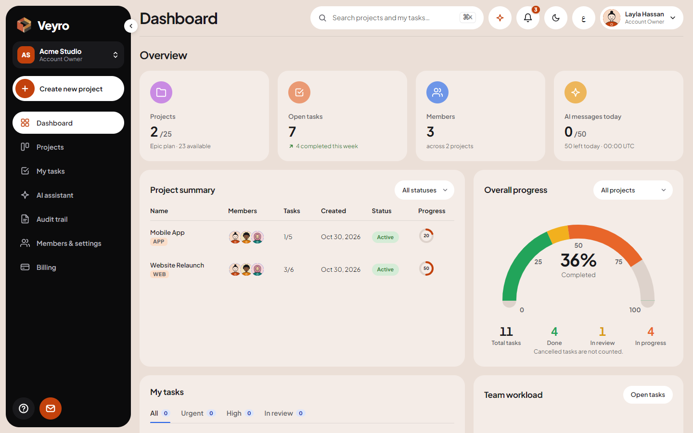
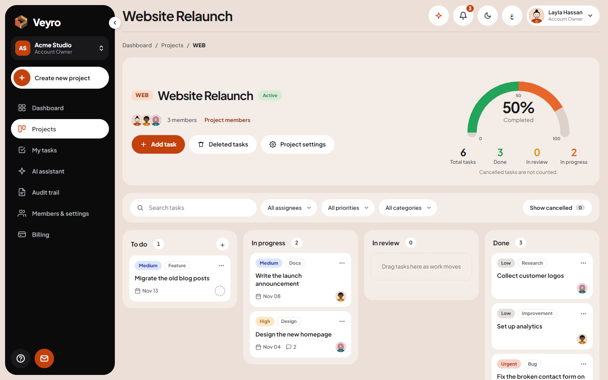
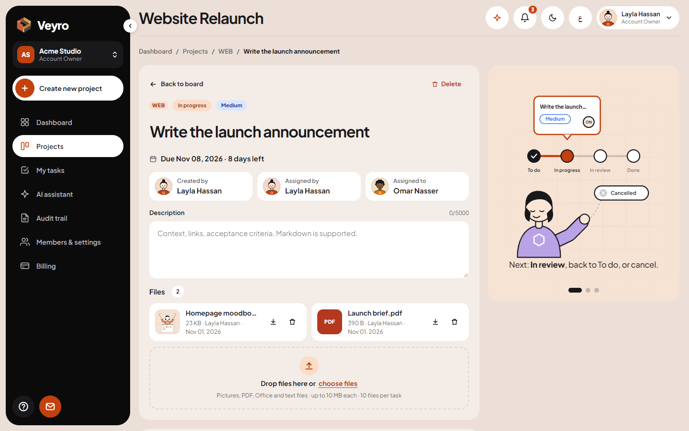
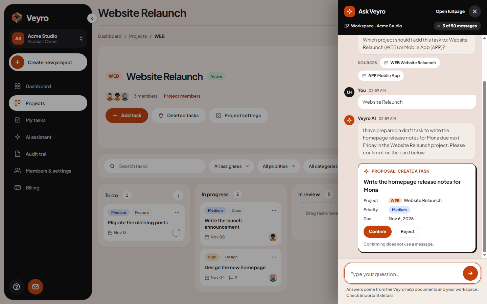
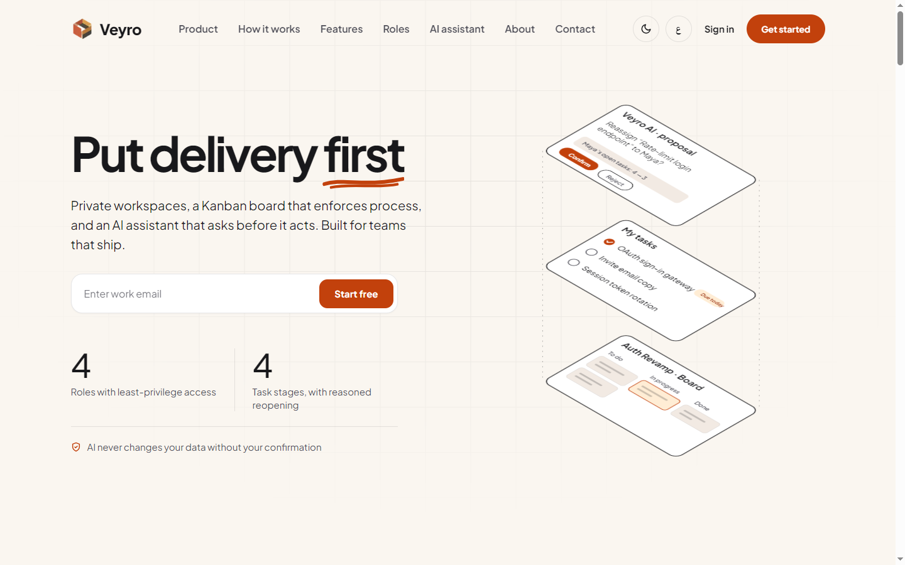
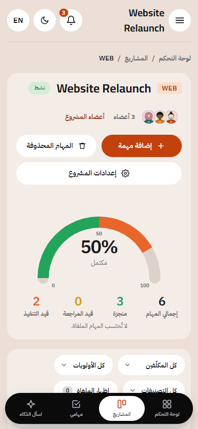
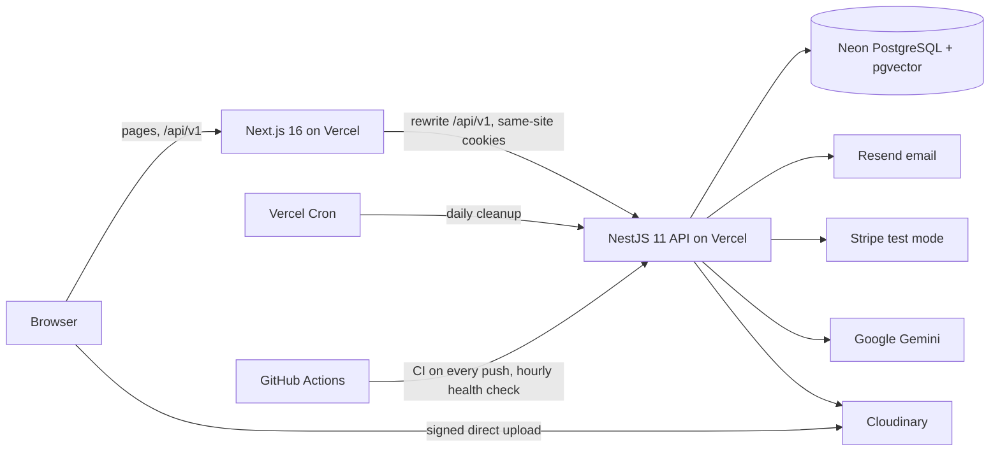

<div align="center">


# Veyro

**Private workspaces for teams: a Kanban board that enforces its rules, and an AI assistant that asks before it acts.**

A multi-tenant project management app built as a modular monolith with NestJS 11, Prisma 7, PostgreSQL (Neon) and Next.js 16. English and Arabic, light and dark.

[](https://github.com/Mohand-Hatem/Veyro/actions/workflows/ci.yml)
[](https://github.com/Mohand-Hatem/Veyro/actions/workflows/health.yml)

**[Live demo → veyro-workspace-app.vercel.app](https://veyro-workspace-app.vercel.app)**

</div>



## Try it

Open the [live demo](https://veyro-workspace-app.vercel.app/en/login) and choose **Try the demo** on the sign-in page. Three people share one workspace, so you can see the same project from each role:

| Person | Role | What they can do |
| :--- | :--- | :--- |
| Layla Hassan | Account owner | Everything, including billing and the account audit trail |
| Omar Nasser | Workspace admin | Run every project, invite people, change roles |
| Mona Adel | Member | Move the tasks assigned to her (with a note), comment, see only her projects |

Google and GitHub sign-in work too. Signing up with an email address is limited in the demo: without a custom domain, the email provider only delivers to the project owner, and the sign-up page says so.

The demo is shared with other visitors. Payments run in Stripe test mode, so no real money moves.

## Screenshots

<table>
  <tr>
    <td width="50%"><br /><sub>The project board: tasks move only through the allowed stages.</sub></td>
    <td width="50%"><br /><sub>The task brief: who created and assigned it, private files, the next allowed steps.</sub></td>
  </tr>
  <tr>
    <td><br /><sub>The assistant drafts a change; nothing is written until a person confirms.</sub></td>
    <td><br /><sub>The public landing page.</sub></td>
  </tr>
</table>

<p align="center"><br /><sub>Arabic, right to left, on a phone.</sub></p>

## What it does

- **Accounts and access:** email sign-up with a code, Google and GitHub sign-in, password reset, invitations locked to the invited address, profile photos (cropped and re-encoded on the server) or illustrated avatars.
- **Workspaces and projects:** an account owns workspaces, workspaces hold private projects, and each project has its own admins and members. A dashboard, a projects list and a "my tasks" view across projects.
- **Tasks:** a board with five states (To do, In progress, In review, Done, Cancelled) and only the allowed moves between them. Reopening a finished task needs a reason. A member who moves their task must leave a note, which becomes a comment. Comments with @mentions (only people who can see the task are told), due dates, categories, a 30-day restore for deleted tasks, and private file attachments that only the assignee, the creator and admins can open.
- **AI assistant:** answers questions about Veyro from its help documents (with sources), answers questions about your workspace through read-only tools, and drafts new tasks or changes as proposals you confirm or reject. Daily limits depend on the plan.
- **Billing:** four plans with project and workspace limits, Stripe Checkout and the customer portal, a 7-day grace period, and choosing which projects stay editable after a downgrade.
- **Trust:** an audit trail per workspace and per account, in-app notifications for assignments, comments, mentions, project additions, role changes and accepted invitations, a toast after every action (success, error or info, each with its own Veyro face), and account deletion with a 30-day purge.

## Architecture



The browser only ever talks to the frontend. Next.js forwards `/api/v1` to the API, so the session cookies stay first-party. The API is one NestJS app split into modules (auth, tenancy, projects, tasks, AI, billing, audit, notifications, storage, email, jobs), sharing one database through Prisma.

Data is organised as **User → Account → Workspaces → Projects → Tasks**. Identity is global and collaboration is scoped: one person can belong to several workspaces with a different role in each. The schema has 26 models; [`backend/prisma/schema.prisma`](backend/prisma/schema.prisma) is the source of truth.

## Engineering decisions

The longer reasoning, with the alternatives and when to revisit each choice, is in the [architecture decision records](docs/adr/).

- **A modular monolith, not microservices.** One deployable, clear module boundaries, transactions across modules when a change must be atomic. Splitting would add network failure modes this product does not need.
- **Tenant isolation everywhere, proven by a test.** Every query is scoped to the caller's workspace and project membership. A private project you are not in returns `404`, not `403`, so its existence does not leak. A test walks every route and fails when a new route is not classified for who may call it.
- **Rights are decided on the server.** Each response includes what the viewer may do (`viewer.canEdit`, `canUpload`, `allowedStatuses`…), and the UI only reflects it. Hiding a button is never the protection.
- **Sessions:** short-lived access tokens and rotating refresh tokens in `HttpOnly` cookies (`SameSite=Lax`, `Secure` in production). Refresh tokens belong to a family, and reusing an old one revokes the whole family.
- **An AI that cannot write.** The model gets read-only tools that see only what the signed-in person may see, the user and workspace come from the server rather than the model, and tool results are treated as data, not instructions. Any change is a stored proposal that the person confirms; rights are checked again at that moment.
- **Events written together.** A task change, its audit row and its notification are written in one transaction, so they exist together or not at all.
- **Files never pass through the API.** The server signs an upload, the browser sends the file straight to Cloudinary as a private resource, then the server checks the name, type and size before saving it. Downloads are links that expire after ten minutes.
- **Payments that tolerate the real world.** Stripe webhooks are verified (signature and timestamp), deduplicated by event id, and re-read the current subscription, so events that arrive late or out of order are safe.

## Tests and CI

| Where | Command | What it covers |
| :--- | :--- | :--- |
| `backend/` | `npm test` | 35 test files, 404 tests against a real database: business and role rules, the tenant-isolation route matrix, plan limits, security, OAuth, Stripe webhooks, the AI gateway and tools, files, notifications and mentions, and journeys across the product. |
| `backend/` | `npm run ai:eval` | 22 cases for the assistant against the real model (help answers, refusals, workspace data, prompt injection, task drafts). Refuses to run on production. |
| `frontend/` | `npm test` | 145 unit tests (vitest), including that every message exists in both languages. |
| `e2e/` | `npx playwright test` | Browser journeys (sign-up, board moves, roles, the task page, status notes, files, mentions), every screen in English and Arabic at desktop and phone width, and the dialogs as full-width, scrollable sheets on a short phone screen. |

**CI** ([`.github/workflows/ci.yml`](.github/workflows/ci.yml)) runs on every push and pull request: frontend lint, types, tests and build; backend lint, types and build; the backend suite against a throwaway Postgres with pgvector; the browser suite against the Docker stack; a Docker job that starts every service and checks `/health`; and `npm audit` for high and critical issues. The **Health** workflow calls the live API every hour and fails, which emails the owner, when the API or its database does not answer.

## Run it locally

Requirements: Node.js 22 and a PostgreSQL database with pgvector (a free Neon project works), or Docker.

```bash
git clone https://github.com/Mohand-Hatem/Veyro.git
cd Veyro
cp backend/.env.example backend/.env           # set DATABASE_URL and JWT_SECRET (32+ characters)
cp frontend/.env.example frontend/.env.local   # the defaults work locally

cd backend && npm install && npx prisma migrate deploy && npm run demo:seed
npm run start:dev                              # API on http://localhost:5000/api/v1

# in a second terminal
cd frontend && npm install && npm run dev      # app on http://localhost:3000
```

The seed prints the three demo addresses; their password is `VeyroDemo2026!` unless you set `DEMO_PASSWORD`. Every external service (Resend, Google and GitHub OAuth, Stripe, Gemini, Cloudinary) is optional in development and listed in `backend/.env.example`; without a key the feature says it is not set up instead of failing. `npm run knowledge:ingest` loads the help documents for the assistant (needs `GEMINI_API_KEY`).

**Without a database account:** `docker compose up --build` starts Postgres with pgvector, applies the migrations and runs the API on port 5000. `docker compose down -v` removes it again.

## Deployment

The demo runs as two Vercel projects from this repository (`frontend/` and `backend/`) with a Neon database ([why, and when to move to a container host](docs/adr/0003-vercel-serverless.md)). What that means in practice:

- **Serverless, honestly:** nothing important lives in memory. Sessions are cookies, AI limits are in the database, and the database connection is pooled. The exception is the request rate limiter (sign-in, sign-up, reset, contact), which counts per function instance, so it is best-effort here; a shared store such as Redis is the upgrade for real traffic.
- **Work after the response** (emails, alerts) runs inside Vercel's `waitUntil`, because a serverless function can be frozen as soon as it answers.
- **Logs:** each request is one JSON line with a request id that is also returned in the `x-request-id` header, so a reported error can be found in the logs.
- **Daily jobs:** Vercel Cron calls a protected endpoint once a day to delete removed photos after 30 days, old notifications after 90 days, accounts deleted from billing, tasks 30 days after they were deleted (with their comments and files), and invitations, sessions, sign-up codes and reset links 30 days after they expired. Every job is safe to run twice; the task purge takes a Postgres advisory lock so two runs never purge the same batch.
- **Email demo mode:** without a domain, Resend's test sender only reaches the project owner. Production refuses that sender unless demo mode is switched on explicitly.
- **Schema changes go first:** an additive migration is applied to production before the code that uses it is pushed, so the running version never meets a column it does not know.

## Limits and what is not built

- The rate limiter is per instance on serverless (see above), and cold starts can make the first request slow.
- No email or push notifications; notifications are in-app only.
- Stripe runs in test mode only.

## How it was built

Veyro was built in eight gated phases: product rules, system design (data model, API contracts, decision records), the backend, the frontend against an approved design system, integration and security, deployment, then hardening (phone layouts, strict types) and data retention. Each step was explained, approved, implemented, tested and reviewed before the next one started.

## License

[MIT](LICENSE)

<div align="center">
  <sub>Built by <strong>Mohand Hatem</strong></sub>
</div>
