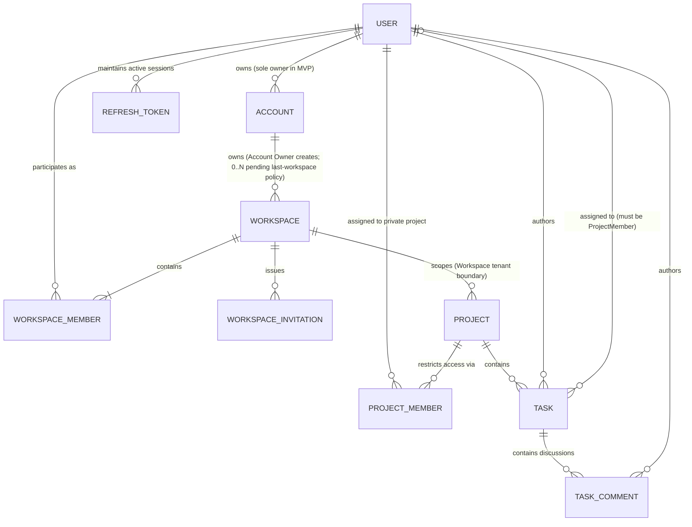
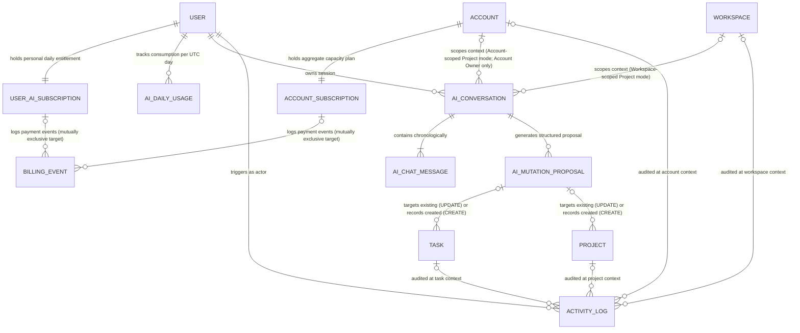

# 04. Entity Relationship Specification & Conceptual Data Model: Veyro

**Document Version:** 2.0.0  
**Phase:** Phase 2 — System Design & Architecture  
**Step:** STEP-2.1B: Formal Entity Relationship Diagram (ERD) & Entity Specification  
**Status:** PHASE 2 — STEP 2.1B APPROVED (Approved on October 12, 2026)  
**Date:** October 12, 2026  
**Parent Documents:** [`01-PROJECT-BRIEF.md`](./01-PROJECT-BRIEF.md), [`02-USER-ROLES-AND-FLOWS.md`](./02-USER-ROLES-AND-FLOWS.md), [`03-BUSINESS-RULES.md`](./03-BUSINESS-RULES.md), [`DECISIONS-TO-APPROVE.md`](./DECISIONS-TO-APPROVE.md), [`AGENTS.md`](../AGENTS.md)

---

## 1. Learning Introduction: ERD Concepts & Data Modeling

Welcome to the **Entity Relationship Specification** for Veyro.  
Before inspecting diagrams and entity definitions, let us review the fundamental software engineering principles governing this design and how to articulate them in technical interviews:

### What Is an ERD (Entity Relationship Diagram)?
An ERD is a visual, structural model that defines how domain entities relate to and interact with one another inside a system's domain. It serves as the architectural blueprint of your data: it establishes who owns what, how authorization cascades, and the relational constraints governing data lifecycle and isolation.

### Entities, Relationships, and Cardinality
1. **Entity:** An independent domain concept with a unique identity (e.g., `User`, `Workspace`, `Project`, `Task`).
2. **Relationship:** The logical association linking two entities (e.g., a User authors a Task, or a Workspace contains Projects).
3. **Cardinality:** The numerical constraints governing how records relate on both sides of an association:
   - **`1:1` (One-to-One):** Each record in Entity A maps to exactly one record in Entity B (e.g., an Account and its aggregate subscription: `Account ||--|| AccountSubscription`).
   - **`1:N` (One-to-Many):** A record in Entity A can relate to multiple records in Entity B, but each record in B belongs to exactly one in A (e.g., `Workspace ||--o{ Project`).
   - **`M:N` (Many-to-Many):** Multiple records in A relate to multiple records in B (e.g., Users participating in multiple Workspaces).  
     **Golden Architectural Rule:** In relational database design, always resolve an `M:N` into an explicit junction/association entity (e.g., `WorkspaceMember`, `ProjectMember`). This allows storing contextual metadata such as membership roles, join timestamps, and authorization state.

### How Is an ERD Derived from Business Requirements?
An ERD is never invented arbitrarily. It is directly extracted from verified business rules. When Phase 1 dictates that *"Projects are private by default and standard members cannot view them unless explicitly assigned"*, this translates directly into a discrete `ProjectMember` junction entity. Without that relationship, the application layer cannot safely filter queries, and data leakage becomes inevitable.

### Conceptual/Logical Model vs. Physical Schema
- **Conceptual / Logical Model:** Focuses on **domain semantics, business relationships, tenant boundaries, and ownership invariants**. It is engine-agnostic: no PostgreSQL column types, no Prisma client syntax, and no physical index configurations are imposed here.
- **Physical Schema (Step 2.2):** The concrete execution blueprint inside `schema.prisma` and SQL DDL (exact table names, column types like `UUID` and `TIMESTAMPTZ`, foreign key cascade actions `ON DELETE RESTRICT / CASCADE`, and composite index strategies).

### Why Are Ownership Boundaries Life-or-Death in Multi-Tenant SaaS?
In multi-tenant SaaS platforms, the most catastrophic failure mode is cross-tenant data leakage or Insecure Direct Object References (IDOR). If ownership boundaries are ambiguous in the ERD (e.g., what belongs to the `Account` for billing versus what belongs to the `Workspace` for daily collaboration, or what belongs to the `Project` for privacy), standard queries can easily expose confidential records across tenant spaces. A strictly defined ERD is the first line of defense against authorization bugs before writing any runtime code.

---

## 2. Purpose and Scope

- **Purpose:** Provide the authoritative conceptual and logical data model for Veyro. Formulate all domain entities, relationships, ownership hierarchies, and security boundaries derived from the locked Phase 1 baseline (`v1.5.2`) and newly approved onboarding decisions.
- **Scope:**
  - Covers the MVP scope of Veyro modeled as a **Modular Monolith**.
  - Covers Identity and Authentication, Multi-Tenant Accounts and Workspaces, Projects and Task Management, Subscription Tiers and Capacity Tracking, System Audit Logs, and AI Assistant Conversations and Vector Embeddings.
  - **Explicit Boundary:** This document is strictly conceptual and logical. It intentionally excludes Prisma code, raw SQL migrations, and premature physical engine optimizations.

---

## 3. Modeling Conventions & Cardinality Legend

All diagrams use standard **Mermaid ERD** notation for native git diffing and visual rendering:

```
  Notation    Meaning
  ────────    ───────
  ||--||      Exactly One to Exactly One (Mandatory 1:1)
  ||--|{      Exactly One to One or More (Mandatory 1:N)
  ||--o{      Exactly One to Zero or More (Optional 1:N)
  |o--o{      Zero or One to Zero or More (Optional 0..1:N)
```

---

## 4. Core Domain ERD

This diagram models the core hierarchy spanning Identity, Multi-Tenancy, Collaboration, and Task Execution:



---

## 5. Supporting AI, Subscription & Audit Model

This diagram models the independent User AI entitlement, Account aggregate subscription, AI conversation lifecycle with context scoping, payment event tracking, and contextual audit logging:



---

## 6. Conceptual Entity Specifications

### 6.1. Identity & Authentication Block

#### 1. `User` (Global Identity)
- **Responsibility:** Represents a unified person across the entire platform, holding credentials, primary email, and global profile metadata.
- **Why it exists:** Provides an independent digital identity uncoupled from any individual tenant or workspace.
- **Phase 1 Traceability:** `FR-1.1`, `DEC-03`, `DEC-14`.
- **Primary Relationships:** Owns accounts (`1:N Account`), maintains sessions (`1:N RefreshToken`), joins workspaces (`M:N Workspace`), holds personal AI subscription (`1:1 UserAiSubscription`), and owns AI conversations (`1:N AiConversation`).
- **Conceptual Attributes:** `id`, `email` (normalized, unique), `passwordHash`, `name`, `avatarUrl`, `createdAt`, `updatedAt`.
- **Ownership & Security Boundary:** Global entity. Does not belong to any specific workspace or account.
- **Lifecycle:** Persistent. Deleted only via explicit account self-deletion requests with account ownership succession (`BR-ACC-02`).
- **Status:** `Required`.

#### 2. `RefreshToken` (Session Security)
- **Responsibility:** Manages long-lived authentication sessions, token rotation chains, and reuse attack detection.
- **Why it exists:** Protects authentication tokens using secure `HttpOnly` cookies without storing raw credentials in the database.
- **Phase 1 Traceability:** `FR-1.2`, `FR-1.3`, `BR-AUTH-02`, `DEC-03`.
- **Primary Relationships:** Belongs to a user (`N:1 User`).
- **Conceptual Attributes:** `id`, `userId`, `hashedToken` (SHA-256), `familyId` (rotation chain tracking), `isRevoked`, `expiresAt`, `createdAt`.
- **Ownership & Security Boundary:** Private to the user. Irreversible cryptographic storage.
- **Lifecycle:** Revoked immediately upon rotation or logout (`revokedAt = NOW()`); purged permanently via background cleanup jobs (`BR-DEL-01`).
- **Status:** `Required`.

---

### 6.2. Tenancy & Collaboration Block

#### 3. `Account` (Billing & Ownership Container)
- **Responsibility:** The root container for billing, subscription tier limits, and aggregate project capacity across all subsidiary workspaces.
- **Why it exists:** Enforces a clean separation between billing ownership and daily workspace collaboration.
- **Phase 1 Traceability:** `BR-ACC-01`, `BR-ACC-02`, `DEC-14`, `DEC-16`, Approved Onboarding Decision (Option A).
- **Primary Relationships:** Owned by a single user (`N:1 User as Owner`), contains zero or more workspaces (`1:N Workspace`), holds account subscription (`1:1 AccountSubscription`), scopes account-level AI conversations for the owner (`1:N AiConversation`).
- **Conceptual Attributes:** `id`, `name`, `slug` (unique), `ownerId`, `createdAt`, `updatedAt`.
- **Ownership & Security Boundary:** Owned strictly by the `Account Owner`. No general "account members" exist in MVP.
- **Lifecycle:** Deletion requires password re-authentication by the owner; cascades down and deletes all associated workspaces and projects (`BR-DEL-01`).
- **Status:** `Required`.

#### 4. `Workspace` (Operational Workspace Container)
- **Responsibility:** The daily operational collaboration container for projects, tasks, invitations, and team members.
- **Why it exists:** Represents the core tenant isolation boundary separating operational projects between business teams.
- **Phase 1 Traceability:** `BR-WS-01`, `DEC-14`, Approved Workspace Creation Decision (Option A).
- **Primary Relationships:** Belongs to an account (`N:1 Account`), contains members (`1:N WorkspaceMember`), issues invitations (`1:N WorkspaceInvitation`), contains projects (`1:N Project`), scopes workspace-level AI conversations (`1:N AiConversation`).
- **Conceptual Attributes:** `id`, `accountId`, `name`, `slug` (unique url-safe), `lifecycleStatus` (`ACTIVE`, `ARCHIVED`), `createdAt`, `updatedAt`.
- **Ownership & Security Boundary:** Scoped to the Account. **Creation is strictly restricted to the Account Owner (`Option A`)**.
- **Lifecycle & Cardinality Note:** During initial onboarding, the Account and first Workspace are created together in a single atomic operation. However, whether an Account Owner may later delete all Workspaces (leaving 0 Workspaces) is an open policy question (see Section 14). The conceptual model allows `Zero or More` (`||--o{`) to avoid imposing an unapproved constraint. Archiving renders all projects read-only; permanent deletion is restricted to the Account Owner and cascades down (`BR-DEL-01`). Empty workspaces consume zero project capacity slots.
- **Status:** `Required`.

#### 5. `WorkspaceMember` (Workspace Membership Junction)
- **Responsibility:** Explicit association entity linking a User to a specific Workspace with assigned permissions.
- **Why it exists:** Resolves the `M:N` relationship between users and workspaces; prevents granting cross-workspace or account-level access.
- **Phase 1 Traceability:** `BR-WS-01`, `BR-WS-02`, `DEC-19`.
- **Primary Relationships:** Links a user (`N:1 User`) to a workspace (`N:1 Workspace`).
- **Conceptual Attributes:** `id`, `workspaceId`, `userId`, `role` (`ADMIN`, `MEMBER`), `joinedAt`.
- **Ownership & Security Boundary:** Scoped to the specified workspace; provides zero visibility into sibling workspaces in the same account.
- **Lifecycle:** Created upon invitation acceptance; removal ejects the member and unassigns them from all tasks in that workspace (`BR-TSK-03`).
- **Status:** `Required`.

#### 6. `WorkspaceInvitation` (Tenant Invitation Record)
- **Responsibility:** Tracks invitations issued to join a specific workspace with secure hashed tokens.
- **Why it exists:** Enables shareable copyable invitation links with email binding and single-use security.
- **Phase 1 Traceability:** `BR-WS-02`, `DEC-04`, `DEC-09`, `FR-2.2`.
- **Primary Relationships:** Belongs to a workspace (`N:1 Workspace`), created by an admin or owner (`N:1 User as Inviter`).
- **Conceptual Attributes:** `id`, `workspaceId`, `email` (normalized), `role` (`ADMIN`, `MEMBER`), `hashedToken` (SHA-256), `status` (`PENDING`, `ACCEPTED`, `REVOKED`, `EXPIRED`), `expiresAt` (createdAt + 7 days), `createdAt`.
- **Ownership & Security Boundary:** Scoped to the workspace; accepting requires an exact email match with the authenticated session (`BR-WS-02.6`).
- **Lifecycle:** Valid for 7 days; transitions to `ACCEPTED` or `REVOKED`; expired tokens are purged periodically.
- **Status:** `Required`.

---

### 6.3. Projects & Task Execution Block

#### 7. `Project` (Task Management Container)
- **Responsibility:** The logical container for tasks; represents the private project boundary and workflow unit.
- **Why it exists:** Provides private task management environments while enforcing aggregate capacity limits across the account.
- **Phase 1 Traceability:** `BR-PRJ-01`, `BR-PRJ-02`, `DEC-05`, `DEC-16`, `BR-SUB-03`.
- **Primary Relationships:** Belongs to a workspace (`N:1 Workspace`), assigned members (`1:N ProjectMember`), contains tasks (`1:N Task`).
- **Conceptual Attributes (State Triad):**
  - Identifiers: `id`, `workspaceId`, `name`, `description`.
  - Workflow State (`lifecycleStatus`): `ACTIVE` or `ARCHIVED` (Archived projects count toward account capacity).
  - Soft-Delete State (`deletedAt`): `NULL` or deletion timestamp (Soft-deleted projects do not count toward capacity).
  - Conceptual Edit Constraint (`accessMode / Read-only`): Enforced when account drops to Free tier (physical representation deferred to schema).
- **Ownership & Security Boundary:** Scoped to workspace; private by default; hidden via `404 Not Found` from workspace members not assigned to it.
- **Lifecycle:** Archiving freezes it; soft-deletion hides it; permanent deletion is manual by Owner/Admin and cascades to tasks (`BR-DEL-01`).
- **Status:** `Required`.

#### 8. `ProjectMember` (Private Project Assignment Junction)
- **Responsibility:** Explicit junction entity granting a user access to a private project and enabling task assignment.
- **Why it exists:** Enforces `DEC-05` and `BR-PRJ-01` (projects are private by default and concealed from non-assigned members).
- **Phase 1 Traceability:** `BR-PRJ-01`, `BR-TSK-03`, `DEC-05`.
- **Primary Relationships:** Links a user (`N:1 User`) to a project (`N:1 Project`).
- **Conceptual Attributes:** `id`, `projectId`, `userId`, `assignedAt`.
- **Ownership & Security Boundary:** Scoped to project and workspace; the user must already be an active `WorkspaceMember`.
- **Lifecycle:** Created upon admin assignment; removal revokes project visibility and unassigns the user from their tasks in that project (`BR-TSK-03.4`).
- **Status:** `Required`.

#### 9. `Task` (Core Work Unit)
- **Responsibility:** Represents an actionable task, its strict state machine, priority, author, and assignee.
- **Why it exists:** Core productivity unit in Veyro for tracking collaborative deliverables.
- **Phase 1 Traceability:** `BR-TSK-01`, `BR-TSK-02`, `BR-TSK-03`, `BR-TSK-04`, `BR-DEL-02`, `DEC-10`, `DEC-11`.
- **Primary Relationships:** Belongs to a project (`N:1 Project`), authored by a user (`N:1 User as Author`), optionally assigned to a user (`N:1 User as Assignee`), contains comments (`1:N TaskComment`).
- **Conceptual Attributes:** `id`, `projectId`, `title`, `description`, `status` (`TODO`, `IN_PROGRESS`, `IN_REVIEW`, `DONE`, `CANCELLED`), `priority` (`LOW`, `MEDIUM`, `HIGH`, `URGENT`), `authorId`, `assigneeId` (optional), `dueDate` (UTC timestamp, optional), `deletedAt` (optional soft-delete), `createdAt`, `updatedAt`.
- **Ownership & Security Boundary:** Scoped to project and workspace; assignee must be an explicit `ProjectMember`.
- **Lifecycle & Restoration Permissions:**
  - Governed by a strict state machine (`TODO ➔ IN_PROGRESS ➔ IN_REVIEW ➔ DONE` and `CANCELLED`).
  - Soft-deleted tasks have an exact **30-day recovery window** (`deletedAt >= NOW() - INTERVAL '30 days'`).
  - **Restoration Permissions (`BR-DEL-02.2`):** Strictly the **Task Author, Workspace Admin, or Account Owner** may restore a soft-deleted task (`POST /api/tasks/:id/restore`). Restoration is permitted only if the containing project is currently `ACTIVE` (returns `409 Conflict` if the project is archived or deleted).
  - **Reopening / Reinstating Permissions (`BR-TSK-01.1`):** Strictly the **Task Author, Workspace Admin, or Account Owner** may reopen a completed task (`DONE ➔ IN_PROGRESS`) or reinstate a cancelled task (`CANCELLED ➔ TODO`), requiring a mandatory reason of at least 5 characters documented in comments and audit logs.
  - Automatically purged permanently after 30 days by a scheduled background cleanup job executing within a transaction with safe concurrency locking to prevent race conditions (`BR-DEL-02.4`).
- **Status:** `Required`.

#### 10. `TaskComment` (Task Discussion & Audit Thread)
- **Responsibility:** Captures discussion comments on a task and records mandatory reopening reasons.
- **Why it exists:** Supports collaboration and enforces `DEC-10` by documenting task reopening reasons directly in the conversation thread.
- **Phase 1 Traceability:** `BR-TSK-01.4`, `BR-DEL-01`, `DEC-10`.
- **Primary Relationships:** Belongs to a task (`N:1 Task`), authored by a user (`N:1 User`).
- **Conceptual Attributes:** `id`, `taskId`, `authorId`, `content`, `deletedAt` (soft-delete masks content with a placeholder), `createdAt`, `updatedAt`.
- **Ownership & Security Boundary:** Scoped to the task; editable/deletable only by the author or workspace admin.
- **Lifecycle:** Soft-deletion conceals content; permanently deleted upon parent task cascade deletion.
- **Status:** `Required`.

---

### 6.4. Billing & Subscription Block

#### 11. `AccountSubscription` (Account Plan & Aggregate Capacity)
- **Responsibility:** Tracks account plan tier, aggregate workspace/project limits, payment lifecycle status, billing periods, and grace periods.
- **Why it exists:** Enforces aggregate account capacity limits independently from the individual user AI subscription.
- **Phase 1 Traceability:** `BR-SUB-02`, `BR-SUB-03`, `DEC-16`.
- **Primary Relationships:** Belongs to an account (`1:1 Account`), associated with billing events (`1:N BillingEvent`).
- **Conceptual Attributes (Tier vs. Lifecycle Separation):**
  - Identifiers: `id`, `accountId`.
  - Plan Tier (`tier`): `FREE`, `PRO`, `ENTERPRISE`, `EPIC`.
  - Payment / Lifecycle Status (`status`): `ACTIVE`, `PAST_DUE`, `DOWNGRADED`.
  - Cancellation Tracking (`cancelAtPeriodEnd`): Boolean flag (or `canceledAt` timestamp) recording a manual cancellation request while preserving paid benefits.
  - Billing Cycle (`billingCycleEndsAt`): UTC timestamp marking the expiration of the current paid period.
  - Grace Period (`gracePeriodEndsAt`): UTC timestamp defining the 7-day grace window upon payment failure.
  - Downgrade Enforcement (`requiresProjectSelection`): Boolean flag set upon downgrade to Free, locking unselected projects into Read-only.
  - Provider Integration (`providerCustomerId`, `providerSubscriptionId`): Generic string identifiers (deferred).
- **Ownership & Security Boundary:** Managed strictly by the Account Owner.
- **Lifecycle & Cancellation Behavior:** Defaults to `FREE`; upgrades upon confirmed billing webhook. If payment fails, enters a 7-day `PAST_DUE` grace period with full plan benefits. If manual cancellation is requested (`cancelAtPeriodEnd = true`), **paid benefits remain fully active until `billingCycleEndsAt`** (`BR-SUB-03.4`). When `billingCycleEndsAt` passes without renewal, the subscription transitions to `DOWNGRADED` under Free limits, placing all projects on temporary Read-only hold until the Account Owner selects up to 3 active projects.
- **Status:** `Required`.

#### 12. `UserAiSubscription` (Personal AI Subscription)
- **Responsibility:** Manages personal AI entitlement, plan tier, daily message quota, and billing cycle tied directly to the user's global identity.
- **Why it exists:** Implements `DEC-15` and `DEC-22` establishing that AI quotas follow the individual user across all workspaces and knowledge mode.
- **Phase 1 Traceability:** `BR-SUB-01`, `DEC-15`, `DEC-22`.
- **Primary Relationships:** Belongs to a user (`1:1 User`), associated with billing events (`1:N BillingEvent`).
- **Conceptual Attributes (Tier vs. Lifecycle Separation):**
  - Identifiers: `id`, `userId`.
  - Plan Tier (`tier`): `FREE`, `PRO`, `ENTERPRISE`, `EPIC`.
  - Daily Entitlement (`dailyQuota`): Integer limit derived from tier (3, 15, 25, 50).
  - Payment / Lifecycle Status (`status`): `ACTIVE`, `PAST_DUE`, `DOWNGRADED_FREE`.
  - Cancellation Tracking (`cancelAtPeriodEnd`): Boolean flag (or `canceledAt` timestamp) recording manual cancellation.
  - Billing Cycle (`billingCycleEndsAt`): UTC timestamp marking the end of the current monthly billing period.
  - Grace Period (`gracePeriodEndsAt`): UTC timestamp defining the 7-day grace window upon monthly renewal failure.
  - Provider Integration (`providerCustomerId`): Generic string identifier (deferred).
- **Ownership & Security Boundary:** Tied strictly to the user identity; portable across all accounts and workspaces.
- **Lifecycle & Cancellation Behavior:** Renews monthly. If monthly renewal payment fails, enters a 7-day `PAST_DUE` grace period with full daily quota. If manual cancellation is requested (`cancelAtPeriodEnd = true`), **paid benefits and full daily quota remain active until `billingCycleEndsAt`** (`BR-SUB-01.8`). When `billingCycleEndsAt` passes without renewal, the subscription transitions to `FREE` (3 messages/day) with zero data loss (`BR-SUB-01.7`).
- **Status:** `Required`.

#### 13. `AiDailyUsage` (Daily Consumption Counter)
- **Responsibility:** Tracks daily message consumption and resets automatically at `00:00 UTC`.
- **Why it exists:** Enforces plan quota boundaries accurately (deducts 1 token on successful generation, 0 tokens on confirmation or errors) without locking tables with heavy cron jobs.
- **Phase 1 Traceability:** `BR-SUB-01.4`, `DEC-15`, `DEC-23`.
- **Primary Relationships:** Belongs to a user (`N:1 User`).
- **Conceptual Attributes:** `id`, `userId`, `usageDate` (Date at UTC), `messagesUsed` (counter), `createdAt`, `updatedAt`.
- **Ownership & Security Boundary:** Scoped to the user; evaluated before dispatching queries to the LLM.
- **Lifecycle:** Date-partitioned logical records; resets automatically on new UTC calendar dates.
- **Status:** `Required`.

#### 14. `BillingEvent` (Payment & Lifecycle Audit Log — Provisional)
- **Responsibility:** Records immutable payment transactions, subscription lifecycle events (payment succeeded, payment failed, renewals, cancellations, refunds) originating from external billing webhooks.
- **Why it exists:**
  1. Financial audit trail for both organizational Account subscriptions and personal User AI subscriptions.
  2. Webhook Idempotency: Stores the external provider event ID (`externalEventId`, e.g., Stripe's `evt_xxx`). When a webhook arrives, the system verifies whether an event with this ID already exists. If present, it skips reprocessing to prevent duplicate credit, double billing, or multiple quota increments.
- **Mutually Exclusive Target Rule:** Each `BillingEvent` belongs to **exactly one** subscription type: either `AccountSubscription` OR `UserAiSubscription`, never both and never neither (exclusive XOR association).
- **Phase 1 Traceability:** Derived from payment verification requirements (`BR-SUB-01.9`, `BR-SUB-03.3`).
- **Primary Relationships:** Associated with either `AccountSubscription` (`N:1 AccountSubscription`) OR `UserAiSubscription` (`N:1 UserAiSubscription`).
- **Conceptual Attributes:** `id`, `targetType` (`ACCOUNT_SUBSCRIPTION`, `USER_AI_SUBSCRIPTION`), `accountSubscriptionId` (optional/nullable), `userAiSubscriptionId` (optional/nullable), `eventType` (`PAYMENT_SUCCEEDED`, `PAYMENT_FAILED`, `SUBSCRIPTION_RENEWED`, `SUBSCRIPTION_CANCELED`), `externalEventId` (unique idempotency key), `amount`, `currency`, `occurredAt`.
- **Ownership & Security Boundary:** Immutable audit log accessible only by the Account Owner (for Account events) or the individual User (for AI events).
- **Physical Schema Deferred:** Whether this exclusive association is physically implemented via two nullable foreign keys with a database XOR CHECK constraint, a polymorphic pair `(targetType, targetId)`, or separate discrete tables is strictly deferred to STEP-2.2.
- **Status:** `Provisional (Recommended Awaiting Review)`.

---

### 6.5. AI Assistant & Vector Knowledge Block

#### 15. `AiConversation` (AI Conversation Session)
- **Responsibility:** Manages the conversational container between user and AI assistant, establishing the retrieval mode (`KNOWLEDGE` vs `PROJECT`) and context scoping (`GLOBAL`, `WORKSPACE`, `ACCOUNT`).
- **Why it exists:** Supports workspace-agnostic Knowledge Mode for any user, Workspace-scoped Project Mode for workspace collaborators, and Account-scoped Project Mode for the Account Owner's overarching administrative governance.
- **Phase 1 Traceability:** `BR-AI-01`, `BR-AI-05`, `02-USER-ROLES-AND-FLOWS.md` Section 1.1 (Account Owner administrative oversight).
- **Primary Relationships:**
  - Owned by a user (`N:1 User`).
  - Optionally references an account (`N:1 Account`, nullable; populated in Account-scoped Project mode).
  - Optionally references a workspace (`N:1 Workspace`, nullable; populated in Workspace-scoped Project mode).
  - Contains messages (`1:N AiChatMessage`).
  - Contains mutation proposals (`1:N AiMutationProposal`).
- **Conceptual Attributes:**
  - `id`: Unique identifier.
  - `userId`: Global user identity who owns the conversation.
  - `mode`: High-level operational mode (`KNOWLEDGE`, `PROJECT`).
  - `contextScope`: Contextual boundary (`GLOBAL`, `WORKSPACE`, `ACCOUNT`).
  - `accountId`: Nullable (`NULL` for Knowledge mode and Workspace-scoped Project mode; required `NOT NULL` for Account-scoped Project mode).
  - `workspaceId`: Nullable (`NULL` for Knowledge mode and Account-scoped Project mode; required `NOT NULL` for Workspace-scoped Project mode).
  - `title`, `createdAt`, `updatedAt`.

##### Valid Context Invariant Combinations

The conceptual model strictly defines and permits only the following three valid combinations:

| Mode (`mode`) | Context Scope (`contextScope`) | `accountId` | `workspaceId` | Permitted Roles | Conceptual Rules & Invariants |
| :--- | :--- | :---: | :---: | :--- | :--- |
| **`KNOWLEDGE`** | **`GLOBAL`** | **`NULL`** | **`NULL`** | Any authenticated `User` | **Knowledge Mode:** Requires zero tenant context. Grounded strictly in public documentation (`PublicKnowledgeChunk`). Accessible to any authenticated user regardless of Workspace or Account membership. |
| **`PROJECT`** | **`WORKSPACE`** | **`NULL`** | **`NOT NULL`** | `Workspace Admin`, `Workspace Member`, `Account Owner` | **Workspace-Scoped Project Mode:** Explicitly bound to a single Workspace. Context retrieval is bounded by that Workspace (and pre-filtered strictly to assigned projects via `ProjectMember` for standard Workspace Members). |
| **`PROJECT`** | **`ACCOUNT`** | **`NOT NULL`** | **`NULL`** | **`Account Owner` strictly** | **Account-Scoped Project Mode:** Explicitly bound to the Account. **Restricted exclusively to the verified Account Owner.** Retrieves authorized context across all active Workspaces and Projects belonging to the owned Account. |

##### Disallowed / Invalid Conceptual Combinations
The model conceptually disallows any combination outside the three valid rows above:
1. **No Mixed Tenant Foreign Keys:** A conversation cannot simultaneously reference an Account and a Workspace (`accountId NOT NULL AND workspaceId NOT NULL` is strictly invalid).
2. **No Tenant Scopes in Knowledge Mode:** `KNOWLEDGE` mode with a non-null `accountId` or non-null `workspaceId` is strictly invalid.
3. **No Unscoped Project Mode:** `PROJECT` mode with both `accountId = NULL` and `workspaceId = NULL` is strictly invalid.
4. **No Cross-Mode Mismatches:** Pairs such as `KNOWLEDGE` + `WORKSPACE`, `KNOWLEDGE` + `ACCOUNT`, or `PROJECT` + `GLOBAL` are strictly invalid.
5. **No Unauthorized Account-Scoped Access:** `PROJECT` + `ACCOUNT` initiated or accessed by a `Workspace Admin` or `Workspace Member` is rejected server-side (`403 Forbidden`).

*(Note: Physical constraint enforcement via database CHECK constraints or application validation guards is deferred to STEP-2.2).*
- **Status:** `Required`.

#### 16. `AiChatMessage` (Interactive Chat Message)
- **Responsibility:** Stores user prompts and assistant responses along with structured source citations.
- **Why it exists:** Preserves conversation context and enforces explicit citations (`BR-AI-03`).
- **Phase 1 Traceability:** `BR-AI-03`, `BR-AI-05`.
- **Primary Relationships:** Belongs to a conversation (`N:1 AiConversation`).
- **Conceptual Attributes:** `id`, `conversationId`, `senderRole` (`USER`, `ASSISTANT`), `content`, `citations` (structured references to Task Keys or Documentation sections), `createdAt`.
- **Ownership & Security Boundary:** Inherits conversation boundaries; subject to sensitive data sanitization before storage (`BR-AI-05.2`).
- **Status:** `Required`.

#### 17. `AiMutationProposal` (Structured Mutation Proposal)
- **Responsibility:** Encapsulates proposed project or task creations/modifications generated by AI awaiting user confirmation.
- **Why it exists:** Enforces `BR-AI-09` and `DEC-18` (AI cannot mutate database records autonomously; all mutations require human approval and atomic backend execution).
- **Phase 1 Traceability:** `BR-AI-08`, `BR-AI-09`, `DEC-17`, `DEC-18`.
- **Conceptual Distinction Between `UPDATE` vs. `CREATE` Proposals:**
  1. **`UPDATE` Action:** The proposal targets an **existing** `Project` or `Task` that already exists in the database. The relationship represents a direct link to that target record.
  2. **`CREATE` Action:** The target entity **does not yet exist** in the database when the proposal is generated. The proposal encapsulates the candidate payload (e.g., proposed title, description, priority). Only upon explicit human confirmation and successful atomic execution by the backend is the new Project or Task created, at which point a link to the newly instantiated entity is recorded for auditability and lineage tracking.
- **Explicit Target Scoping for Account-Scoped Mutation Proposals:**
  When a proposal originates from an Account-scoped conversation (`PROJECT` + `ACCOUNT`):
  - **Creating a Project (`mutationAction: CREATE`, `targetEntityType: PROJECT`):** Requires an explicit target Workspace (`targetWorkspaceId`) belonging to the Account.
  - **Creating a Task (`mutationAction: CREATE`, `targetEntityType: TASK`):** Requires an explicit target Project (`targetProjectId`) belonging to a Workspace in the Account.
  - **Modifying a Project or Task (`mutationAction: UPDATE`):** Requires the target entity (`targetEntityId`) to belong to the Account.
- **Atomic Backend Revalidation at Confirmation Time:**
  The LLM's generated proposal is untrusted candidate data; the LLM is **never** an authorization or business boundary (`BR-AI-02`). At confirmation time (`POST /api/ai/proposals/:id/confirm`), the NestJS backend executes an atomic transaction (`prisma.$transaction`) that strictly revalidates:
  1. **Actor Authorization:** Verify the confirming user has appropriate permissions (strictly `Account Owner` for Account-scoped proposals).
  2. **Target Resource Ownership & Scope:**
     - For Project CREATE: Verify `targetWorkspaceId` belongs to the Account (`workspace.accountId == account.id`).
     - For Task CREATE: Verify `targetProjectId` belongs to a Workspace in the Account (`project.workspace.accountId == account.id`).
     - For UPDATE: Verify the target entity belongs to the Account.
  3. **Target Resource Lifecycle State:**
     - For Project CREATE: Target Workspace must be `ACTIVE` (cannot create projects in an `ARCHIVED` workspace).
     - For Task CREATE: Target Project must be `ACTIVE` (cannot create tasks in an `ARCHIVED`, soft-deleted, or `Read-only` project; `BR-TSK-01.2`, `BR-DEL-02.2`).
  4. **Applicable Subscription Capacity:**
     - For Project CREATE: Revalidate that total active + archived projects in the Account do not exceed the Account subscription plan's project limit (`BR-SUB-02`, `BR-SUB-03`).
  - *If any validation fails, the transaction rolls back atomically without partial mutations.*
- **Primary Relationships:** Belongs to a conversation (`N:1 AiConversation`), references an existing entity (for `UPDATE`) or links to the created entity upon execution (for `CREATE`).
- **Conceptual Attributes:** `id`, `conversationId`, `targetEntityType` (`PROJECT`, `TASK`), `mutationAction` (`CREATE`, `UPDATE`), `targetEntityId` (optional; references existing entity for UPDATE, populated post-execution for CREATE), `targetWorkspaceId` (mandatory for Project CREATE proposals), `targetProjectId` (mandatory for Task CREATE proposals), `proposedPayload` (JSON diff/preview), `status` (`PENDING`, `CONFIRMED`, `REJECTED`, `EXECUTED`, `FAILED`), `createdAt`, `executedAt`.
- **Ownership & Security Boundary:** Visible to the conversation owner; execution re-validates permissions and account capacity at confirmation time.
- **Physical Schema Deferred:** Storage representation (nullable foreign keys vs polymorphic references) is deferred to STEP-2.2.
- **Status:** `Required`.

#### 18. `PublicKnowledgeChunk` (Public Vector Embeddings — Logical Concept)
- **Responsibility:** Represents vectorized text chunks from public Veyro documentation.
- **Why it exists:** Enables Knowledge Mode to answer user questions without accessing any private customer data.
- **Phase 1 Traceability:** `BR-AI-01`, `BR-AI-06`, `DEC-12`.
- **Ownership & Security Boundary:** Public; zero tenant scope (`tenantId IS NULL`, `accountId IS NULL`, `workspaceId IS NULL`); strictly read-only.
- **Status:** `Required Concept (Physical Storage Layout Deferred)`.

#### 19. `WorkspaceEntityEmbedding` (Tenant Vector Embeddings — Logical Concept)
- **Responsibility:** Represents vector embeddings for tenant tasks and projects for semantic retrieval in Project Mode.
- **Why it exists:** Enables AI search within a workspace while ensuring absolute multi-tenant isolation (`BR-AI-06`).
- **Ownership & Role-Aware Pre-LLM Authorization Boundary:**
  - Strictly scoped to tenant records (`workspaceId NOT NULL`, `accountId NOT NULL`).
  - **Pre-LLM Scope & Authorization Filtering:** Authorization and scope filtering execute **server-side before vector similarity search and before private context is injected into LLM prompts**:
    - **Account-Scoped (Account Owner Only):** Retrieves semantic context across **all projects belonging to the Account** they own.
    - **Workspace-Scoped (Workspace Admin & Account Owner):** Retrieves semantic context across **all projects within the selected Workspace**.
    - **Workspace-Scoped (Workspace Member):** Query context is filtered strictly by explicit project assignments via **`ProjectMember`** (`WHERE projectId IN (:assignedProjectIds)`).
  - **Important Architectural Rule:** `ProjectMember` membership is **NOT** a mandatory filter for privileged roles (`Account Owner`, `Workspace Admin`), who hold broader administrative governance under approved business rules (`docs/02-USER-ROLES-AND-FLOWS.md` Section 1.2).
- **Status:** `Required Concept (Physical Storage Layout Deferred)`.

---

### 6.6. Audit & Compliance Block

#### 20. `ActivityLog` (Immutable Audit Trail)
- **Responsibility:** Records security-sensitive operations in an append-only, tamper-evident log.
- **Why it exists:** Guarantees operational transparency, debugging traces, and compliance auditing.
- **Phase 1 Traceability:** `BR-AUD-01`, `NFR-4.1`.
- **Primary Relationships:** Triggered by an actor (`N:1 User as Actor`), scoped to entity contexts (account, workspace, project, task).
- **Conceptual Attributes:** `id`, `actorUserId`, `accountId` (optional context), `workspaceId` (optional context), `projectId` (optional context), `taskId` (optional context), `action` (e.g., `TASK_REOPENED`, `TASK_RESTORED`, `ACCOUNT_DOWNGRADED_FREE`), `metadata` (JSON sanitized attributes), `createdAt`.
- **Ownership & Security Boundary:** Append-only; immutable even by Account Owners; read visibility derives from contextual role permissions.
- **Status:** `Required`.

---

## 7. Relationship & Cardinality Catalog

| Relationship | Cardinality | Ownership Boundary | Enforcement Layer | Engineering Rationale |
| :--- | :---: | :--- | :--- | :--- |
| **`User` ➔ `Account`** | `1:N` | Account Ownership | Application Guard & Foreign Key | A user can own multiple accounts; an account has **exactly one owner** in MVP (`BR-ACC-02`). |
| **`Account` ➔ `Workspace`** | `1:N (0..N, Optional / ||--o{)` | Account Container Boundary | Application Service & Foreign Key | Workspaces belong to one account; **creation is restricted to Account Owner only (`Option A`)**. Cardinality is `Zero or More` pending resolution of the last-workspace deletion rule. |
| **`User` ↔ `Workspace`** | `M:N` via `WorkspaceMember` | Workspace Isolation Boundary | Application Guard & Junction Entity | Joining requires an explicit invitation; grants zero visibility into sibling workspaces in the same account (`DEC-19`). |
| **`Workspace` ➔ `Project`** | `1:N` | Workspace Tenant Boundary | Tenant Scope & Foreign Key | Projects belong to one workspace; project transfers between accounts are disallowed in MVP (`DEC-20`). |
| **`User` ↔ `Project`** | `M:N` via `ProjectMember` | Project Privacy Boundary | Pre-Query Filter & Junction Entity | Projects are private by default (`BR-PRJ-01`); concealed via 404 from unassigned workspace members. |
| **`Project` ➔ `Task`** | `1:N` | Project Boundary | Foreign Key & Tenant Extension | Tasks strictly belong to one project and workspace to eliminate cross-tenant confusion. |
| **`Task` ➔ `User` (Author)** | `N:1` | Permission Boundary | Service Logic & Foreign Key | Task Author, Workspace Admin, or Account Owner may reopen a completed task or restore a soft-deleted task (`BR-TSK-01`, `BR-DEL-02`). |
| **`Task` ➔ `User` (Assignee)** | `N:1` (Optional) | Project Membership Boundary | Validation Guard & Foreign Key | Assignee must be an explicit member of the project (`ProjectMember`) under `BR-TSK-03`. |
| **`Task` ➔ `TaskComment`** | `1:N` | Task Boundary | Cascade Delete & Foreign Key | Comments belong to the task; automatically documents mandatory reopening reasons (`DEC-10`). |
| **`User` ➔ `RefreshToken`** | `1:N` | Session Security Boundary | Auth Guard & Foreign Key | Tracks hashed session tokens across user devices with rotation and reuse detection (`BR-AUTH-02`). |
| **`Workspace` ➔ `WorkspaceInvitation`** | `1:N` | Workspace Scope Boundary | Service Logic & Foreign Key | Invitations are bound to a workspace, email address, and 7-day expiration (`BR-WS-02`, `DEC-09`). |
| **`Account` ➔ `AccountSubscription`** | `1:1` | Billing Lifecycle Boundary | Service Layer & Unique Key | Manages account plan tier, aggregate project limits, 7-day grace period, and downgrade state (`DEC-16`). |
| **`User` ➔ `UserAiSubscription`** | `1:1` | Identity Entitlement Boundary | Service Layer & Unique Key | AI subscription belongs to the user identity and remains independent of workspaces or accounts (`DEC-15`). |
| **`User` ➔ `AiDailyUsage`** | `1:N` (Per UTC Day) | Quota Accounting Boundary | Service Layer & Unique Constraint | Tracks daily consumption reset at `00:00 UTC` (1 token for generation, 0 for confirmation) (`DEC-23`). |
| **`AccountSubscription` / `UserAiSubscription` ➔ `BillingEvent`** | `1:N` (Mutually Exclusive) | Financial Audit Boundary | Service Layer & Unique Idempotency Key | Each `BillingEvent` belongs exclusively to either an `AccountSubscription` or a `UserAiSubscription`. `externalEventId` guarantees idempotent webhook handling. |
| **`User` ➔ `AiConversation`** | `1:N` | User Identity Boundary | Foreign Key | Conversations belong to the user. |
| **`Account` ➔ `AiConversation`** | `1:N (0..N, Optional / |o--o{)` | Account Oversight Boundary | Foreign Key (Nullable) | Scopes Account-level Project conversations (`accountId NOT NULL`, `workspaceId = NULL`); restricted exclusively to the Account Owner. |
| **`Workspace` ➔ `AiConversation`** | `1:N (0..N, Optional / |o--o{)` | Workspace Tenant Boundary | Foreign Key (Nullable) | Scopes Workspace-level Project conversations (`workspaceId NOT NULL`, `accountId = NULL`); available to authorized Workspace Admins, Members, and Owner. *(Knowledge conversations set both `accountId = NULL` and `workspaceId = NULL`)*. |
| **`AiConversation` ➔ `AiChatMessage`** | `1:N` | Conversation Boundary | Foreign Key | Messages are ordered chronologically and contain source citations and generation status (`BR-AI-03`). |
| **`AiConversation` ➔ `AiMutationProposal`** | `1:N` | Change Proposal Boundary | Foreign Key | AI-generated mutation proposals await human confirmation before atomic execution (`DEC-18`). |
| **`AiMutationProposal` ➔ `Project` / `Task`** | `0..1:1` | Mutation Target Boundary | Service Logic & Deferred Schema Pattern | Targets an existing entity for `UPDATE`. For `CREATE`, requires an explicit target Workspace (for Project CREATE) or an explicit target Project (for Task CREATE) within the Account, re-validated atomically before instantiation. |
| **Contextual Entities ➔ `ActivityLog`** | `1:N` | Multi-Context Audit Trail | Event Interceptor & Foreign Keys | Logs sensitive actions across multiple context dimensions (`accountId`, `workspaceId`, `projectId`, `taskId`, `actorUserId`). |

---

## 8. Ownership & Authorization Boundaries

The platform enforces a three-tier hierarchical isolation model:

```
[Account Level: Account Owner Only]
       │
       ▼
[Workspace Level: Workspace Admin & Members]
       │
       ▼
[Project Level: Explicit Assigned Members]
```

### A. Hierarchical Operational Roles:
1. **Account Owner:**
   - Holds exclusive billing and subscription management authority.
   - Holds exclusive rights to create new Workspaces under the Account (`Option A`).
   - Maintains administrative oversight across all Workspaces and Projects belonging to the Account.
   - Has exclusive authorization to initiate Account-scoped Project AI conversations spanning all Workspaces in the Account (`contextScope: ACCOUNT`, `accountId NOT NULL`, `workspaceId = NULL`).
   - Can confirm AI mutation proposals in Account-scoped conversations with explicit target Workspace/Project selection, subject to atomic backend revalidation.
   - Holds exclusive responsibility for selecting active editable projects upon downgrade to Free (`Downgrade Selection`).
   - Has full authority to reopen completed tasks or restore soft-deleted tasks across all projects in the Account (`BR-DEL-02.2`).
2. **Workspace Admin:**
   - Manages projects, members, and invitations **only within their authorized Workspace**.
   - **Cannot** create additional Workspaces under the Account.
   - Has administrative visibility over all projects within their authorized Workspace.
   - Can initiate Workspace-scoped Project AI conversations bounded to their authorized Workspace (`contextScope: WORKSPACE`, `workspaceId NOT NULL`, `accountId = NULL`).
   - Has authority to reopen completed tasks or restore soft-deleted tasks for all projects in their authorized Workspace (`BR-DEL-02.2`).
3. **Workspace Member:**
   - Operates within the workspace, but **can only view projects they are explicitly assigned to** via `ProjectMember`.
   - Access attempts to unassigned private projects return **`404 Not Found`** to protect against resource enumeration attacks.
   - Can initiate Workspace-scoped Project AI conversations bounded to their authorized Workspace, with Pre-LLM context strictly pre-filtered to assigned projects.
   - If a Workspace Member is the original **Task Author**, they may reopen their completed task or restore their soft-deleted task, provided the project is `ACTIVE` (`BR-TSK-01.1`, `BR-DEL-02.2`). Non-author members cannot reopen or restore tasks.

### B. Role-Aware Pre-LLM Retrieval Matrix:
In compliance with `BR-AI-02` (the LLM is never an authorization barrier), data retrieval for Project Mode follows real-world permissions **server-side before vector similarity search and before private context is injected into LLM prompts**:
1. **Knowledge Mode (`mode: KNOWLEDGE`, `contextScope: GLOBAL`):**
   - Requires zero tenant context (`accountId = NULL`, `workspaceId = NULL`).
   - Grounded strictly in public documentation (`PublicKnowledgeChunk`).
   - Available to any authenticated User regardless of Workspace or Account membership.
2. **Account-Scoped Project Mode (`mode: PROJECT`, `contextScope: ACCOUNT`):**
   - **Exclusively authorized for the Account Owner.**
   - Pre-LLM retrieval retrieves context across all active Workspaces and Projects belonging to the owned Account (`WHERE accountId = :accountId`).
   - Workspace Admins and Members cannot initiate or access Account-scoped conversations.
3. **Workspace-Scoped Project Mode (`mode: PROJECT`, `contextScope: WORKSPACE`):**
   - **If the requester is Account Owner or Workspace Admin:** Retrieves context across all projects within the authorized Workspace (`WHERE workspaceId = :workspaceId`).
   - **If the requester is Workspace Member:** Queries are filtered strictly at the database layer (`WHERE workspaceId = :workspaceId AND projectId IN (:assignedProjectIds)`). The model receives zero context from unassigned private projects.
4. **Privileged Scope Invariant:** `ProjectMember` membership is **NOT** required for Account Owners or Workspace Admins to retrieve context within their authorized domains.

---

## 9. Lifecycle & Subscription Invariants

### A. Project State Triad:
1. **Operational State (`lifecycleStatus`):**  
   - `ACTIVE`: Available for task creation and active updates.
   - `ARCHIVED`: Voluntary freeze; tasks become read-only and cannot be reopened or created; **archived projects count toward account project capacity** (`BR-SUB-02`).
2. **Soft-Deleted State (`deletedAt`):**  
   - Temporarily deleted and hidden from views; **does not count toward account project capacity**.
   - Restoring a project requires available capacity in the account plan (`BR-DEL-02.3`).
   - **Invariant:** The 30-day automatic purge window applies strictly to Tasks. Project permanent deletion is manual by Owner/Admin.
3. **Subscription Edit Constraint (`Read-only`):**  
   - Access constraint resulting from downgrade to Free after grace period expiration.
   - Physical representation deferred to schema design (no premature column assumed).

### B. Free Downgrade Behavior:
- When the 7-day grace period expires, Free limits are enforced (maximum 1 Workspace and 3 Projects per Account).
- **All projects in the Account transition temporarily to `Read-only`** until the Owner explicitly selects active projects.
- The Owner explicitly designates up to 3 projects to remain editable; no automatic or hidden selections occur.
- Archived projects remain `ARCHIVED` even if selected.
- Unselected projects remain `Read-only`.
- **Zero data loss:** No project or task is deleted as a consequence of plan downgrades.
- Subsequent upgrades require explicit manual re-activation by the Owner for locked projects.

### C. Task State Machine & Restoration Lifecycle:
- Five discrete states: `TODO ➔ IN_PROGRESS ➔ IN_REVIEW ➔ DONE` and `CANCELLED`.
- **Reopening & Reinstating (`BR-TSK-01`):** Reopening (`DONE ➔ IN_PROGRESS`) or reinstating (`CANCELLED ➔ TODO`) is strictly restricted to the **Task Author, Workspace Admin, or Account Owner**, and requires a mandatory reason string (minimum 5 characters) appended to comments and audit logs.
- **Soft-Deletion & 30-Day Recovery Window (`BR-DEL-02`):**
  - A task can be soft-deleted (`deletedAt = NOW()`) by the **Task Author, Workspace Admin, or Account Owner**.
  - It remains restorable for exactly **30 calendar days** (`deletedAt >= NOW() - INTERVAL '30 days'`).
  - **Restoration Permissions:** The **Task Author, Workspace Admin, or Account Owner** may restore a soft-deleted task (`POST /api/tasks/:id/restore`).
  - **Precondition:** The containing project must be `ACTIVE` (returns `409 Conflict` if parent project is archived or deleted).
  - Tasks older than 30 calendar days are permanently purged by a scheduled background cleanup job executing with transaction-level concurrency locking to prevent concurrent purge execution across application instances (`BR-DEL-02.4`).

### D. AI Daily Quota Accounting:
- User-centric entitlement: Free: 3, Pro: 15, Enterprise: 25, Epic: 50 messages/day.
- Resets daily at `00:00 UTC`.
- Strict accounting rules:
  - Generating a response or mutation proposal = deducts 1 message (even if proposal is rejected).
  - Confirming and executing a previously generated proposal = deducts **0 additional messages**.
  - Provider service failures = deducts **0 messages**.
  - Internal idempotency retries = zero duplicate deduction.
- Technical anti-abuse rate limiting is handled as a separate operational concern, decoupled from the daily business quota.

### E. Manual Cancellation & Period-End Retention Invariant:
- Applies symmetrically to both `AccountSubscription` (`BR-SUB-03.4`) and `UserAiSubscription` (`BR-SUB-01.8`).
- **Paid Benefits Retention:** When a paid subscription is manually canceled, paid benefits do **not** terminate immediately.
- The subscription sets `cancelAtPeriodEnd = true`, preserving its paid tier and active capabilities until the expiration of the current billing cycle (`billingCycleEndsAt`).
- Upon reaching `billingCycleEndsAt` without renewal:
  - `AccountSubscription` transitions to `DOWNGRADED` under Free limits (initiating the project hold selection flow).
  - `UserAiSubscription` transitions to `FREE` (3 messages/day) with zero data loss.

### F. AI Mutation Proposal Confirmation & Execution Invariants:
1. **Untrusted LLM Output (`BR-AI-02`):** AI mutation proposals are structured candidate data awaiting explicit human confirmation. The LLM is never an authorization barrier or transactional authority.
2. **Target Scope Requirements:**
   - **Project Creation (`CREATE`):** For Account-scoped proposals, must designate an explicit target Workspace belonging to the Account (`targetWorkspaceId`).
   - **Task Creation (`CREATE`):** Must designate an explicit target Project belonging to the authorized Workspace/Account (`targetProjectId`).
   - **Resource Modification (`UPDATE`):** Must reference an existing target entity (`targetEntityId`) within the authorized scope.
3. **Confirmation-Time Lifecycle, Hierarchy & Permission Revalidation (`BR-AI-09`, `DEC-18`):**
   When the user confirms a proposal (`POST /api/ai/proposals/:id/confirm`), the backend executes an atomic database transaction (`prisma.$transaction`) that strictly revalidates all permissions and lifecycle restrictions across the entire resource hierarchy at confirmation time—even if they were valid when the proposal was initially generated:
   - **Project CREATE Validation:**
     - Target Workspace must exist and belong to the authorized Account.
     - Target Workspace must remain active and writable (`lifecycleStatus = ACTIVE`, not archived; `BR-WS-01`).
     - Account must possess available project capacity under its subscription plan (`BR-SUB-02.3`).
   - **Task CREATE Validation (Inherited Ancestor Lifecycle Check):**
     - Target Project must exist, belong to the authorized scope (authorized Workspace and Account), and remain active (`lifecycleStatus = ACTIVE`).
     - Target Project must not be soft-deleted (`deletedAt IS NULL`) and must not be in subscription `Read-only` hold (`BR-SUB-03.2`).
     - **Parent Workspace Lifecycle Invariant:** The parent Workspace of the target Project must also remain active and writable (`lifecycleStatus = ACTIVE`, not archived). If either the parent Project or parent Workspace prevents task creation, the proposal is rejected.
   - **Project UPDATE Validation (Ancestor & Self Lifecycle Check):**
     - Target Project must still exist in the database and remain accessible to the confirming user under current authorization rules.
     - **Unconditional Rejection for Non-Writable Projects:** An AI Project UPDATE proposal must be rejected unconditionally if any of the following apply:
       1. The Project is archived (`lifecycleStatus = ARCHIVED`). Approved AI capabilities permit Project name and description updates on active projects only; AI cannot unarchive projects, and archived projects are strictly frozen (`BR-PRJ-02`).
       2. The Project is soft-deleted (`deletedAt IS NOT NULL`). (Soft-deleted projects cannot be modified via AI and must be explicitly restored first; `BR-DEL-02.3`).
       3. The Project is subject to a subscription `Read-only` restriction (`BR-SUB-03.2`).
       4. Its parent Workspace is archived (`lifecycleStatus = ARCHIVED`) or otherwise non-writable under approved lifecycle rules (`BR-WS-01`).
   - **Task UPDATE Validation (Full Ancestor Hierarchy Lifecycle Check):**
     - Target Task must still exist in the database and remain accessible to the confirming user.
     - Target Task must not be soft-deleted (`deletedAt IS NULL`). Soft-deleted tasks cannot be modified via AI; they must first be explicitly restored by an authorized role (`BR-DEL-02.2`).
     - **Parent Project Lifecycle Invariant:** The containing Project must remain active (`lifecycleStatus = ACTIVE`), not soft-deleted (`deletedAt IS NULL`), and not in subscription `Read-only` hold. An archived or read-only parent Project freezes all its tasks (`BR-PRJ-02`).
     - **Parent Workspace Lifecycle Invariant:** The parent Workspace must remain active and writable (`lifecycleStatus = ACTIVE`). An archived Workspace cascades read-only restrictions down to all projects and tasks (`BR-WS-01`).
     - *If any ancestor resource makes the Task read-only, the update proposal is rejected.*
   - **Actor Authorization Revalidation:** Confirming user must possess the required permissions for the target scope at execution time (e.g., Account Owner strictly for Account-scoped proposals; Workspace Admin or Member with project assignment for their respective scopes).
   - **Atomic Execution & Rollback:** All validation checks and state mutations execute within an atomic transaction. Any hierarchy, lifecycle, capacity, or authorization failure immediately rolls back the transaction with zero partial state changes.

---

## 10. Billing Payment Record Decision (Provisional)

### A. Problem Addressed by `BillingEvent`:
In SaaS applications managing recurring subscriptions and 7-day grace periods:
- Updating only the current subscription record (`AccountSubscription.status = 'ACTIVE'`) discards financial history: when payments failed, how many retries occurred, and when grace periods began.
- Webhook idempotency is essential: Payment providers frequently resend webhooks upon transient network timeouts. The system must verify the unique `externalEventId` to prevent duplicate crediting or repeated subscription state mutations.

### B. Scope & Mutual Exclusivity:
- `BillingEvent` covers **both** Account subscriptions and personal AI subscriptions.
- Each billing event record links to **exactly one** subscription type: either `AccountSubscription` OR `UserAiSubscription`, never both and never neither.
- Physical implementation patterns (two nullable foreign keys with an XOR check constraint vs polymorphic columns vs discrete tables) are deferred to STEP-2.2.

### C. Recommendation & Gating Status:
- **Recommendation:** Adopt **`BillingEvent`** as a provisional entity supporting billing operations in Veyro.
- **Classification:** **`Provisional (Recommended Awaiting Review)`** — Presented here as a technical recommendation subject to human approval; it is not a closed Phase 1 decision. Gateway-specific fields remain agnostic until implementation.

---

## 11. Modeling Alternatives & Trade-offs

| Design Decision | Chosen / Recommended Approach | Rejected Alternative | Engineering Rationale |
| :--- | :--- | :--- | :--- |
| **Account Ownership & Membership** | Direct field `Account.ownerId` | Junction table `AccountMember` with roles | In MVP, an Account has exactly one owner (`BR-ACC-02`) and workspace creation belongs exclusively to the owner (`Option A`). An `AccountMember` table introduces false hierarchies and implies non-existent account-level permissions. |
| **Account–Workspace Cardinality** | `1:N (Zero or More, ||--o{)` | Mandatory minimum `1:N (||--|{)` | While initial onboarding creates an Account and Workspace atomically, no approved rule forbids an owner from deleting all workspaces later. Specifying `Zero or More` avoids enforcing an unapproved constraint. |
| **Workspace & Project Membership** | Explicit junction entities (`WorkspaceMember`, `ProjectMember`) | Implicit Many-to-Many relations | Explicit entities store membership roles, join dates, and assignment metadata, enabling strict project privacy and `404` enforcement. |
| **AI Conversation Context Scope** | Unified `AiConversation` with contextual scopes (`GLOBAL`, `WORKSPACE`, `ACCOUNT`) | Discrete tables or separate top-level modes | Enforces strict foreign key invariants: Knowledge sets both FKs to NULL; Workspace requires `workspaceId` with `accountId = NULL`; Account requires `accountId` with `workspaceId = NULL` (restricted to Account Owner). Eliminates schema duplication while preserving absolute tenant isolation. |
| **`AiMutationProposal` Target Modeling** | Distinct handling for `UPDATE` (existing entity) vs `CREATE` (instantiated post-execution) with explicit scope targets | Unified mandatory foreign key | A proposed entity does not exist in the database before execution; mandating an existing foreign key would make `CREATE` proposals unrepresentable. For Account-scoped proposals, requiring explicit target Workspace/Project ensures clean hierarchical containment. |
| **Billing Event Association** | Single `BillingEvent` with mutually exclusive target (`AccountSubscription` XOR `UserAiSubscription`) | Two separate billing event tables or untyped account-only logs | Unifies webhook processing architecture and idempotency verification while strictly isolating organizational billing from personal AI billing. |
| **Vector Knowledge Embeddings** | Logical distinction between Public and Tenant knowledge | Premature physical table structures | Keeps semantic boundaries clean while deferring physical storage choices (single table vs dual tables) to the schema performance review. |
| **Daily AI Quota Tracking** | Composite daily log record `(userId, usageDate)` | In-place counter on User with cron reset | Date-partitioned records reset automatically when a new UTC day starts, avoiding table locks and bottlenecks associated with midnight cron jobs. |

---

## 12. Deferred Physical-Schema Questions

The following implementation details are intentionally deferred to **`STEP-2.2 (Physical Schema)`**:
1. **Physical representation of Project `Read-only` state:** Stored as an explicit boolean column on `projects` versus dynamically computed from account subscription state and active project selections.
2. **`BillingEvent` relational implementation:** Deciding between two nullable foreign keys (`accountSubscriptionId`, `userAiSubscriptionId`) backed by an XOR CHECK constraint versus a polymorphic type/id pair or discrete physical tables.
3. **`AiConversation` context scoping constraint:** Implementing database-level `CHECK` constraints to enforce that:
   - `mode = 'KNOWLEDGE'` has `accountId IS NULL AND workspaceId IS NULL`.
   - `mode = 'PROJECT' AND contextScope = 'WORKSPACE'` has `workspaceId IS NOT NULL AND accountId IS NULL`.
   - `mode = 'PROJECT' AND contextScope = 'ACCOUNT'` has `accountId IS NOT NULL AND workspaceId IS NULL`.
4. **`AiMutationProposal` physical target linkage:** Deciding between nullable foreign keys (`targetProjectId`, `targetWorkspaceId`, `targetEntityId`) versus a structured JSON reference and execution event log.
5. **Cancellation period-end job execution:** Deciding how the scheduled downgrade job queries subscriptions where `cancelAtPeriodEnd = true AND billingCycleEndsAt <= NOW()`.
6. **Concurrency locking primitive for scheduled task purge:** Implementing transaction-level advisory locks (such as PostgreSQL's `pg_try_advisory_xact_lock`) versus alternative application-level job locking mechanisms.
7. **`pgvector` indexing strategy:** Exact vector dimensions and index algorithms (`HNSW` vs `IVFFlat`) deferred until hosting infrastructure is verified per `DEC-12`.
8. **Payment provider IDs:** Keeping provider customer and subscription fields generic strings since provider selection is `TBD` per `DEC-21`.
9. **Physical identifiers & indexing:** Standardizing on `UUIDv4` for tenant resources and designing composite indexes `(workspaceId, id)` for optimized query performance.

---

## 13. Traceability Matrix

| Entity / Relational Concept | Phase 1 Decision Reference | Business Rules & Requirements Reference |
| :--- | :--- | :--- |
| **`User`** | `DEC-01`, `DEC-03`, `DEC-14` | `FR-1.1`, `FR-1.4`, `BR-ACC-01` |
| **`RefreshToken`** | `DEC-03` | `FR-1.2`, `FR-1.3`, `BR-AUTH-02`, `BR-DEL-01` |
| **`Account`** | `DEC-14`, `DEC-16`, Onboarding Decision | `FR-2.1`, `BR-ACC-01`, `BR-ACC-02` |
| **`Workspace`** | `DEC-14`, Workspace Creation Decision | `FR-2.1`, `BR-WS-01`, `BR-DEL-01` |
| **`WorkspaceMember`** | `DEC-14`, `DEC-19` | `FR-2.2`, `BR-WS-01`, `BR-WS-02`, `BR-ISO-01` |
| **`WorkspaceInvitation`** | `DEC-04`, `DEC-09`, `DEC-19` | `FR-2.2`, `BR-WS-02`, `BR-DEL-01` |
| **`Project`** | `DEC-05`, `DEC-06`, `DEC-07`, `DEC-16` | `FR-3.1`, `BR-PRJ-01`, `BR-PRJ-02`, `BR-SUB-03` |
| **`ProjectMember`** | `DEC-05` | `FR-3.1`, `BR-PRJ-01`, `BR-TSK-03` |
| **`Task`** | `DEC-10`, `DEC-11` | `FR-4.1`, `BR-TSK-01`, `BR-TSK-02`, `BR-DEL-02` |
| **`TaskComment`** | `DEC-10` | `FR-4.4`, `BR-TSK-01.4`, `BR-DEL-01` |
| **`AccountSubscription`** | `DEC-16`, `DEC-21` | `FR-7.6`, `FR-7.7`, `BR-SUB-02`, `BR-SUB-03` |
| **`UserAiSubscription`** | `DEC-15`, `DEC-22` | `FR-7.1`, `FR-7.4`, `BR-SUB-01` |
| **`AiDailyUsage`** | `DEC-15`, `DEC-23` | `FR-7.2`, `FR-7.3`, `BR-SUB-01`, `BR-AI-09` |
| **`BillingEvent`** | `DEC-16`, `DEC-21` (Provisional) | `FR-7.4`, `FR-7.7`, `BR-SUB-01.9`, `BR-SUB-03.3` |
| **`AiConversation` & `AiChatMessage`** | `DEC-15`, `DEC-17` | `FR-6.1`, `BR-AI-01`, `BR-AI-03`, `BR-AI-05`, `02-USER-ROLES-AND-FLOWS.md` §1.1 |
| **`AiMutationProposal`** | `DEC-17`, `DEC-18`, `DEC-23` | `FR-6.2`, `BR-AI-08`, `BR-AI-09` |
| **`ActivityLog`** | `DEC-10`, `DEC-18` | `FR-5.1`, `BR-AUD-01`, `NFR-4.1` |
| **`Vector Knowledge Embeddings`** | `DEC-12`, `DEC-13` | `BR-AI-06`, `NFR-1.5` |

---

## 14. Open Modeling Questions for Human Review & Validation Checklist

### Open Modeling Questions Requiring Human Confirmation:
1. **Account–Workspace Minimum Constraint:**  
   - *Question:* Does Veyro require every Account to permanently contain at least one Workspace (prohibiting the Account Owner from deleting their last remaining Workspace unless the entire Account is deleted)?  
   - *Current Status:* Modeled as `Zero or More` (`1:N (0..N, ||--o{)`) because no approved rule currently forbids deleting the last workspace. If the desired policy is to forbid deleting the final workspace, the cardinality will be adjusted to `1:N (1..N, ||--|{)`.
2. **Subscription Cancellation Reversal Policy:**  
   - *Question:* If an Account Owner or User sets `cancelAtPeriodEnd = true`, are they permitted to reverse/cancel the pending cancellation prior to `billingCycleEndsAt` without issuing a new subscription checkout flow?  
   - *Current Status:* Modeled with `cancelAtPeriodEnd` flag; reversal behavior is noted as an operational question for payment gateway integration.
3. **Account-Scoped AI Conversation UX Presentation:**  
   - *Question:* In Phase 1 (`docs/02-USER-ROLES-AND-FLOWS.md` §1.1), the Account Owner has administrative oversight across all Workspaces in the Account, while `docs/03-BUSINESS-RULES.md` (`BR-AI-01`) defines conversation modes as `KNOWLEDGE` and `PROJECT`. Does the UI present Account-scoped AI as an executive query view within an Account Overview dashboard, or as an explicit scope selector when launching a Project Mode conversation?  
   - *Current Status:* Modeled cleanly as a contextual scope dimension (`GLOBAL`, `WORKSPACE`, `ACCOUNT`) within the approved `PROJECT` mode, restricted exclusively to the Account Owner with mandatory target workspace selection on project creation.

### Completed Checklist for STEP-2.1B:
- [x] Verified against locked Phase 1 specifications and `AGENTS.md` rules.
- [x] Structured diagrams using valid Mermaid ERD syntax.
- [x] Explicitly defined the 3 valid invariant combinations of `mode`, `contextScope`, `accountId`, and `workspaceId`.
- [x] Conceptually disallowed invalid mixed or orphaned foreign key combinations.
- [x] Extended Account-scoped mutation proposals to cover Project CREATE (target Workspace required) and Task CREATE (target Project required).
- [x] Formulated the 4-point atomic backend revalidation checklist at confirmation time (Authorization, Target Scope, Lifecycle State, Subscription Capacity).
- [x] Re-affirmed that the LLM is never an authorization boundary (`BR-AI-02`) and mutations execute atomically (`BR-AI-09`).
- [x] Preserved previously resolved BillingEvent, subscription cancellation, task restoration, and Account-Workspace cardinality rules.
- [x] Changes scoped strictly to `docs/04-ENTITY-RELATIONSHIP-SPECIFICATION.md` without modifying other files.
- [x] Fully rendered and maintained in professional English.

### Proposed Next Step:
Upon your review and approval of this revised document:  
Proceed to **`STEP-2.2: Physical Database Schema Design (Prisma Client & PostgreSQL Specification)`** to translate these conceptual entities into a production-grade `schema.prisma` file with concrete data types, foreign keys, cascade rules, and composite indexes.

---

*(End of Entity Relationship Specification — Awaiting Human Review and Approval)*
