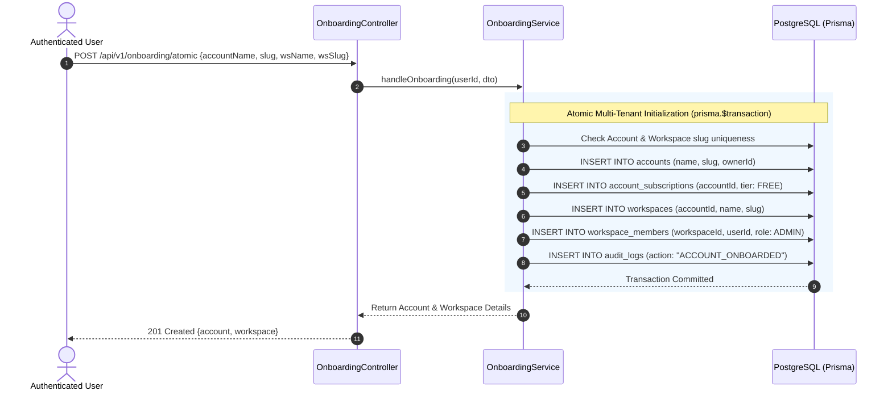
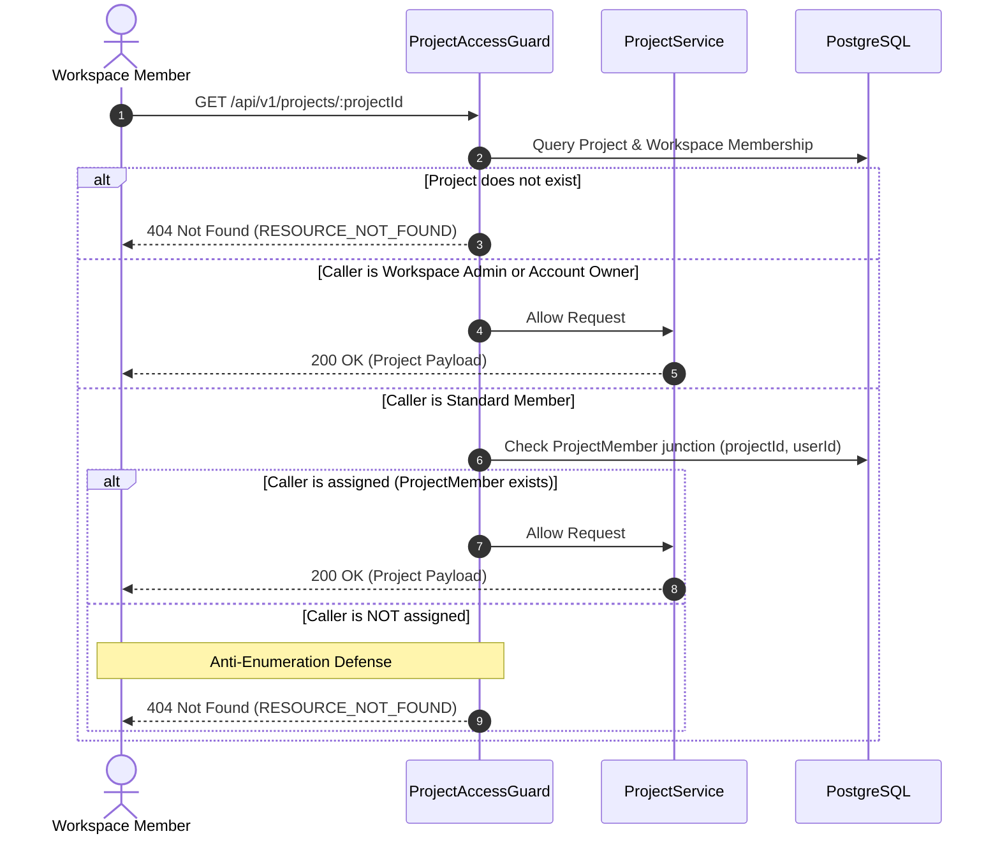
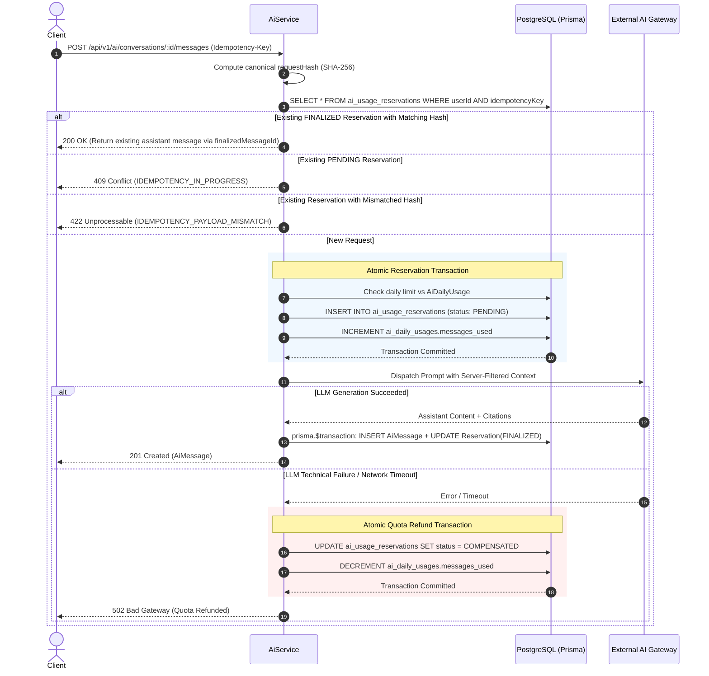
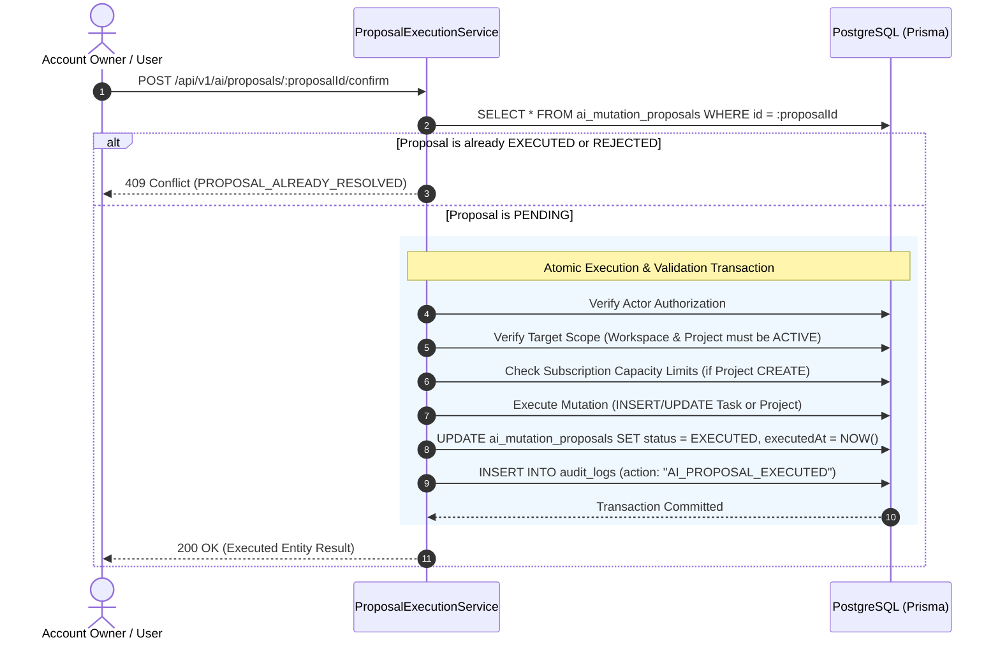
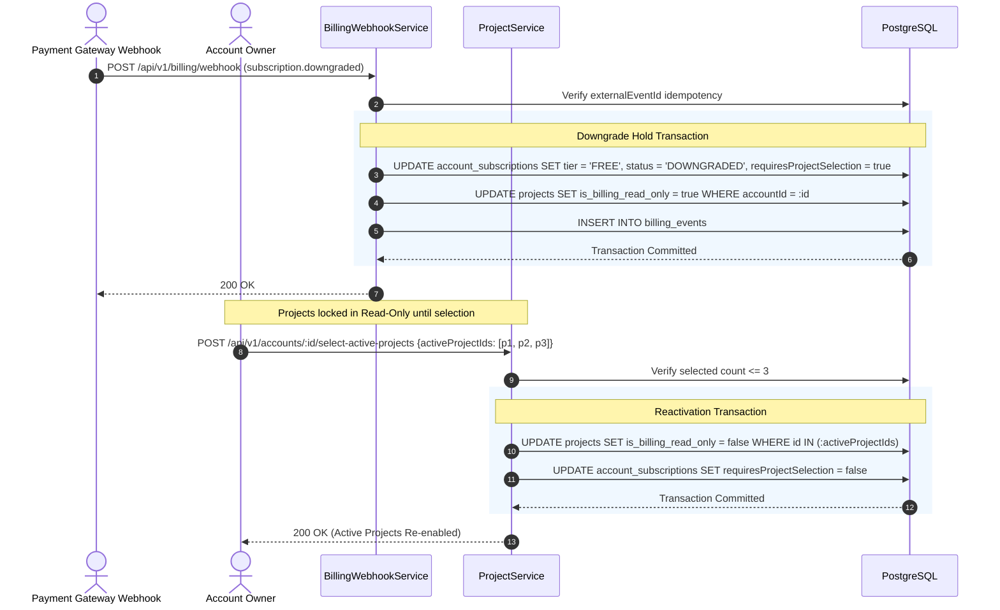
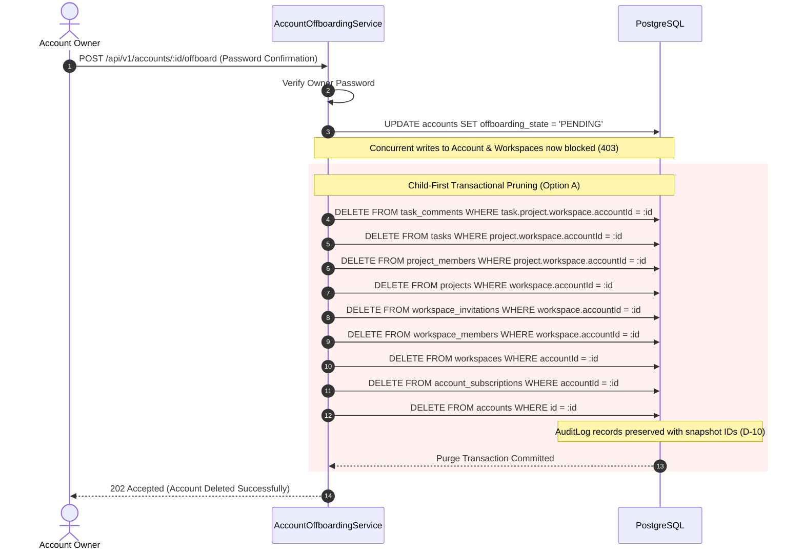

# 06. API Contracts & Sequence Diagrams Specification: Veyro

**Document Version:** 1.0.0  
**Phase:** Phase 2 — System Design & Architecture  
**Step:** STEP-2.3: API Contracts & Sequence Diagrams Specification  
**Status:** PHASE 2 — STEP-2.3 APPROVED & COMPLETED  
**Date:** October 12, 2026  
**Architecture:** Modular Monolith (NestJS / Next.js App Router)  
**Parent Documents:** [`docs/01-PROJECT-BRIEF.md`](./01-PROJECT-BRIEF.md), [`docs/02-USER-ROLES-AND-FLOWS.md`](./02-USER-ROLES-AND-FLOWS.md), [`docs/03-BUSINESS-RULES.md`](./03-BUSINESS-RULES.md), [`docs/04-ENTITY-RELATIONSHIP-SPECIFICATION.md`](./04-ENTITY-RELATIONSHIP-SPECIFICATION.md), [`docs/05-PHYSICAL-DATABASE-SPECIFICATION.md`](./05-PHYSICAL-DATABASE-SPECIFICATION.md)

---

## 1. Global API Standards & Conventions

All Veyro REST API endpoints strictly adhere to uniform architectural standards across all modules:

### 1.1. Base URL & Protocol
- **Base Path:** `/api/v1`
- **Transport:** HTTPS strictly enforced in production.
- **Content-Type:** `application/json` (requests and responses).
- **Character Encoding:** UTF-8.

### 1.2. Authentication & Session Handling
- **Mechanism:** Secure `HttpOnly`, `SameSite=Lax` (or `Strict`), `Secure` cookies.
- **Access Token:** Short-lived JWT (15 minutes).
- **Refresh Token:** Cryptographically hashed (`UserSession.hashedToken`), managed via token family rotation (`familyId`) to detect and neutralize reuse attacks (`BR-AUTH-02`).
- **Unauthenticated Handling:** Returns `401 Unauthorized`.

### 1.3. Standard Response Envelopes

Every endpoint returns a consistent JSON envelope to ensure predictable frontend parsing:

#### Success Envelope (`2xx`)
```json
{
  "success": true,
  "data": { ... },
  "meta": {
    "requestId": "req_clh1234567890",
    "timestamp": "2026-10-12T04:00:00.000Z"
  }
}
```

#### Paginated Success Envelope (`2xx`)
```json
{
  "success": true,
  "data": [ ... ],
  "pagination": {
    "page": 1,
    "limit": 20,
    "totalCount": 85,
    "totalPages": 5,
    "hasNextPage": true,
    "hasPrevPage": false
  },
  "meta": {
    "requestId": "req_clh1234567890",
    "timestamp": "2026-10-12T04:00:00.000Z"
  }
}
```

#### Error Envelope (`4xx` / `5xx`)
```json
{
  "success": false,
  "error": {
    "code": "STRING_ERROR_CODE",
    "message": "Human-readable description of the error.",
    "details": [
      {
        "field": "title",
        "issue": "Title must be between 3 and 255 characters."
      }
    ]
  },
  "meta": {
    "requestId": "req_clh1234567890",
    "timestamp": "2026-10-12T04:00:00.000Z"
  }
}
```

### 1.4. Standard HTTP Status & Error Codes Catalog

| HTTP Status | Error Code (`error.code`) | Description & Scenarios |
|-------------|---------------------------|-------------------------|
| `200 OK` | — | Successful query or synchronous update. |
| `201 Created` | — | Successful resource creation. |
| `204 No Content` | — | Successful deletion or state change returning zero body. |
| `400 Bad Request` | `VALIDATION_FAILED` | Malformed JSON or input validation constraint violation. |
| `401 Unauthorized` | `AUTHENTICATION_REQUIRED` | Missing, expired, or revoked authentication session. |
| `403 Forbidden` | `PERMISSION_DENIED` | Authenticated user lacks role permissions. |
| `403 Forbidden` | `ACCOUNT_OFFBOARDING_LOCKED` | Account is undergoing offboarding (`offboardingState = PENDING`). |
| `403 Forbidden` | `PROJECT_BILLING_READ_ONLY` | Project is locked on Free tier downgrade hold (`isBillingReadOnly = true`). |
| `404 Not Found` | `RESOURCE_NOT_FOUND` | Resource does not exist, OR private project unassigned to user (**Anti-Enumeration**). |
| `409 Conflict` | `CONFLICT_STATE` | State machine transition disallowed, or stale concurrent update. |
| `409 Conflict` | `IDEMPOTENCY_IN_PROGRESS` | AI quota reservation is currently `PENDING` for this key. |
| `422 Unprocessable` | `IDEMPOTENCY_PAYLOAD_MISMATCH` | Idempotency key reused with mismatched request parameters or body. |
| `429 Too Many Requests` | `AI_QUOTA_EXCEEDED` | Daily AI quota exhausted for user's tier. |
| `429 Too Many Requests` | `RATE_LIMIT_EXCEEDED` | General API rate limit exceeded. |
| `500 Internal Error` | `INTERNAL_SERVER_ERROR` | Unexpected unhandled server exception. |

---

## 2. Module API Contracts

---

### 2.1. Authentication & Identity Module

#### `POST /api/v1/auth/register`
- **Description:** Registers a new user identity and initiates atomic onboarding.
- **Access:** Public.
- **Request Body:**
  ```json
  {
    "email": "user@example.com",
    "password": "SecurePassword123!",
    "name": "Jane Doe"
  }
  ```
- **Responses:**
  - `201 Created`: User created, session cookie set.
    ```json
    {
      "success": true,
      "data": {
        "user": {
          "id": "clh_usr_1234567890",
          "email": "user@example.com",
          "name": "Jane Doe",
          "avatarUrl": null,
          "createdAt": "2026-10-12T04:00:00.000Z"
        }
      }
    }
    ```
  - `400 Bad Request`: Validation failure (weak password, invalid email format).
  - `409 Conflict`: Email already registered (`EMAIL_ALREADY_EXISTS`).

#### `POST /api/v1/auth/login`
- **Description:** Authenticates user credentials and establishes a new session chain.
- **Access:** Public.
- **Request Body:**
  ```json
  {
    "email": "user@example.com",
    "password": "SecurePassword123!"
  }
  ```
- **Responses:**
  - `200 OK`: Successful authentication. Sets `Set-Cookie: sessionId=...; HttpOnly; Secure; SameSite=Lax`.
  - `401 Unauthorized`: Invalid email or password.

#### `POST /api/v1/auth/refresh`
- **Description:** Rotates long-lived session tokens, issuing a new access token and rotating `UserSession`.
- **Access:** Authenticated (via Cookie).
- **Responses:**
  - `200 OK`: Token rotated, updated session cookie returned.
  - `401 Unauthorized`: Token expired or token reuse detected (family revoked).

#### `POST /api/v1/auth/logout`
- **Description:** Revokes current `UserSession` and clears session cookies.
- **Access:** Authenticated.
- **Responses:**
  - `200 OK`: Session revoked and cookie cleared.

#### `GET /api/v1/auth/me`
- **Description:** Returns the active authenticated user profile and memberships.
- **Access:** Authenticated.
- **Responses:**
  - `200 OK`:
    ```json
    {
      "success": true,
      "data": {
        "id": "clh_usr_1234567890",
        "email": "user@example.com",
        "name": "Jane Doe",
        "avatarUrl": null,
        "ownedAccounts": [
          { "id": "clh_acc_111", "name": "Acme Corp", "slug": "acme-corp" }
        ],
        "workspaces": [
          { "id": "clh_ws_222", "name": "Engineering", "slug": "acme-eng", "role": "ADMIN" }
        ]
      }
    }
    ```

---

### 2.2. Accounts & Workspaces Module

#### `POST /api/v1/onboarding/atomic`
- **Description:** Executes atomic onboarding: creates `Account`, first `Workspace`, and assigns caller as `Account Owner` and `Workspace ADMIN` (`BR-ACC-01`, Option A).
- **Access:** Authenticated user without existing account.
- **Request Body:**
  ```json
  {
    "accountName": "Acme Global",
    "accountSlug": "acme-global",
    "workspaceName": "Engineering",
    "workspaceSlug": "acme-global-eng"
  }
  ```
- **Responses:**
  - `201 Created`:
    ```json
    {
      "success": true,
      "data": {
        "account": { "id": "clh_acc_111", "name": "Acme Global", "slug": "acme-global" },
        "workspace": { "id": "clh_ws_222", "name": "Engineering", "slug": "acme-global-eng" }
      }
    }
    ```
  - `409 Conflict`: Account slug or workspace slug already taken.

#### `POST /api/v1/accounts/:id/workspaces`
- **Description:** Creates an additional workspace under the account. Restricted strictly to the Account Owner (`Option A`).
- **Access:** Authenticated (`Account Owner` strictly).
- **Path Params:** `id: string` (Account ID).
- **Request Body:**
  ```json
  {
    "name": "Design & Marketing",
    "slug": "acme-global-design"
  }
  ```
- **Responses:**
  - `201 Created`: Workspace created.
  - `403 Forbidden`: Caller is not the Account Owner.
  - `409 Conflict`: Workspace slug already in use.

#### `POST /api/v1/accounts/:id/offboard`
- **Description:** Initiates account offboarding. Sets `offboardingState = PENDING`, cancels subscription, and begins background child-first purge.
- **Access:** Authenticated (`Account Owner` strictly with password confirmation).
- **Request Body:**
  ```json
  {
    "passwordConfirmation": "SecurePassword123!"
  }
  ```
- **Responses:**
  - `202 Accepted`: Offboarding accepted and processing.
  - `401 Unauthorized`: Incorrect password confirmation.
  - `403 Forbidden`: Caller is not Account Owner.

#### `GET /api/v1/workspaces`
- **Description:** Lists all workspaces the authenticated user is a member of.
- **Access:** Authenticated.
- **Responses:**
  - `200 OK`: Array of workspaces with user's role.

#### `POST /api/v1/workspaces/:id/invitations`
- **Description:** Issues an invitation to join the workspace with a single-use hashed token (`BR-WS-02`).
- **Access:** Authenticated (`Workspace ADMIN` or `Account Owner`).
- **Request Body:**
  ```json
  {
    "email": "colleague@example.com",
    "role": "MEMBER"
  }
  ```
- **Responses:**
  - `201 Created`: Invitation created, valid for 7 days.
  - `403 Forbidden`: Insufficient workspace permissions.
  - `409 Conflict`: Pending invitation already exists for this email.

#### `POST /api/v1/invitations/accept`
- **Description:** Accepts a workspace invitation via raw token.
- **Access:** Authenticated (User email must strictly match invitation email).
- **Request Body:**
  ```json
  {
    "token": "raw_invitation_token_string"
  }
  ```
- **Responses:**
  - `200 OK`: Membership established.
  - `400 Bad Request`: Token expired or revoked.
  - `403 Forbidden`: Authenticated user email does not match invitation recipient.
  - `404 Not Found`: Invalid invitation token.

---

### 2.3. Projects & Task Management Module

#### `GET /api/v1/workspaces/:workspaceId/projects`
- **Description:** Lists projects in the workspace. Automatically filters private projects for standard members (`BR-PRJ-01`).
- **Access:** Authenticated (`Workspace Member`, `Workspace Admin`, `Account Owner`).
- **Responses:**
  - `200 OK`: List of accessible projects. Standard members receive only assigned projects via `ProjectMember`. Admins/Owners receive all workspace projects.

#### `POST /api/v1/workspaces/:workspaceId/projects`
- **Description:** Creates a new private project in the workspace. Checks aggregate account project capacity (`BR-SUB-02`, `BR-SUB-03`).
- **Access:** Authenticated (`Workspace Admin` or `Account Owner`).
- **Request Body:**
  ```json
  {
    "name": "Core Engine Refactor",
    "description": "Refactor monolithic task query service"
  }
  ```
- **Responses:**
  - `201 Created`: Project created.
  - `403 Forbidden`: Account project capacity exceeded for current tier (`PROJECT_CAPACITY_EXCEEDED`).

#### `GET /api/v1/projects/:id`
- **Description:** Retrieves project details.
- **Access:** Authenticated (`ProjectMember`, `Workspace Admin`, `Account Owner`).
- **Security Invariant (Anti-Enumeration):** If user is a Workspace Member but NOT assigned via `ProjectMember`, the server returns **`404 Not Found`** instead of `403 Forbidden`.

#### `DELETE /api/v1/projects/:id`
- **Description:** Soft-deletes a project (`deletedAt = NOW()`).
- **Access:** Authenticated (`Workspace Admin` or `Account Owner`).
- **Responses:**
  - `204 No Content`: Project soft-deleted.

#### `POST /api/v1/projects/:id/members`
- **Description:** Assigns a workspace member to a private project.
- **Access:** Authenticated (`Workspace Admin` or `Account Owner`).
- **Request Body:**
  ```json
  {
    "userId": "clh_usr_555"
  }
  ```
- **Responses:**
  - `201 Created`: Member assigned.
  - `400 Bad Request`: User is not a member of the containing workspace.

#### `GET /api/v1/projects/:projectId/tasks`
- **Description:** Lists tasks in a project with status, priority, and pagination filters.
- **Access:** Authenticated (Project visibility required).
- **Query Params:** `status=TODO,IN_PROGRESS`, `priority=HIGH`, `page=1`, `limit=20`.

#### `POST /api/v1/projects/:projectId/tasks`
- **Description:** Creates a new task in the project.
- **Access:** Authenticated (`ProjectMember`, `Workspace Admin`, `Account Owner`).
- **Constraint:** Cannot create tasks if project is `ARCHIVED`, soft-deleted, or `isBillingReadOnly = true`.
- **Request Body:**
  ```json
  {
    "title": "Implement JWT rotation guard",
    "description": "Add family ID revocation logic",
    "priority": "HIGH",
    "assigneeId": "clh_usr_555",
    "dueDate": "2026-10-20T18:00:00.000Z"
  }
  ```
- **Responses:**
  - `201 Created`: Task created.
  - `400 Bad Request`: Assignee is not a member of this project (`ASSIGNEE_NOT_PROJECT_MEMBER`).
  - `403 Forbidden`: Project is locked due to billing downgrade (`PROJECT_BILLING_READ_ONLY`).

#### `PATCH /api/v1/tasks/:id`
- **Description:** Updates a task's title, description, priority, assignee, or moves state.
- **Access:** Authenticated (`ProjectMember`, `Workspace Admin`, `Account Owner`).
- **State Machine Transitions:**
  - Permitted normal flow: `TODO ➔ IN_PROGRESS ➔ IN_REVIEW ➔ DONE` and `CANCELLED`.
  - Reopening from `DONE` or `CANCELLED` requires dedicated endpoints below (`BR-TSK-01.1`).

#### `POST /api/v1/tasks/:id/reopen`
- **Description:** Reopens a completed or cancelled task. Requires mandatory reason (`BR-TSK-01.1`, `DEC-10`).
- **Access:** Strictly **Task Author, Workspace Admin, or Account Owner**.
- **Request Body:**
  ```json
  {
    "targetStatus": "IN_PROGRESS",
    "reason": "Security audit found regression in token family hash check"
  }
  ```
- **Responses:**
  - `200 OK`: Task status updated, comment added with reason, audit log written.
  - `400 Bad Request`: Reason is missing or shorter than 5 characters.
  - `403 Forbidden`: Caller is not Task Author, Admin, or Owner.
  - `409 Conflict`: Containing project is archived or read-only.

#### `DELETE /api/v1/tasks/:id`
- **Description:** Soft-deletes a task (`deletedAt = NOW()`).
- **Access:** Authenticated (`Task Author`, `Workspace Admin`, `Account Owner`).
- **Responses:**
  - `204 No Content`: Task marked deleted. Eligible for 30-day restore window.

#### `POST /api/v1/tasks/:id/restore`
- **Description:** Restores a soft-deleted task within its 30-day recovery window (`BR-DEL-02.2`).
- **Access:** Strictly **Task Author, Workspace Admin, or Account Owner**.
- **Responses:**
  - `200 OK`: Task restored (`deletedAt = null`).
  - `400 Bad Request`: Recovery window expired (> 30 days).
  - `409 Conflict`: Containing project is archived or deleted.

#### `POST /api/v1/tasks/:id/comments`
- **Description:** Adds a discussion comment to a task.
- **Access:** Authenticated (`ProjectMember`, `Workspace Admin`, `Account Owner`).
- **Request Body:**
  ```json
  {
    "content": "PR is ready for review on feature branch."
  }
  ```
- **Responses:**
  - `201 Created`: Comment appended.

---

### 2.4. Subscriptions & Billing Module

#### `GET /api/v1/accounts/:id/subscription`
- **Description:** Retrieves account subscription plan tier, project limits, and billing status.
- **Access:** Authenticated (`Account Owner` strictly).

#### `GET /api/v1/users/me/ai-subscription`
- **Description:** Retrieves the authenticated user's personal AI subscription tier and daily quota.
- **Access:** Authenticated.

#### `POST /api/v1/billing/webhook`
- **Description:** Idempotent webhook listener for external payment events (Stripe, etc.).
- **Headers:** `Stripe-Signature: ...`
- **Payload:** Raw gateway payload containing `externalEventId` (e.g., `evt_123`).
- **Execution:**
  1. Checks if `externalEventId` exists in `BillingEvent`. If present, returns `200 OK` immediately (Idempotent skip).
  2. Updates `AccountSubscription` or `UserAiSubscription` within a database transaction.
  3. Records `BillingEvent` record.
- **Responses:**
  - `200 OK`: Webhook processed or safely deduplicated.

#### `POST /api/v1/accounts/:id/select-active-projects`
- **Description:** Selects up to 3 projects to remain active after Account downgrade to Free tier (`BR-SUB-03.4`).
- **Access:** Authenticated (`Account Owner` strictly).
- **Request Body:**
  ```json
  {
    "activeProjectIds": ["clh_prj_1", "clh_prj_2", "clh_prj_3"]
  }
  ```
- **Execution:**
  - Marks selected projects `isBillingReadOnly = false`.
  - Marks all other unselected projects `isBillingReadOnly = true`.
  - Sets `AccountSubscription.requiresProjectSelection = false`.
- **Responses:**
  - `200 OK`: Projects re-calibrated.
  - `400 Bad Request`: Exceeds 3 projects or invalid project IDs.

---

### 2.5. AI Assistant & Quota Module

#### `POST /api/v1/ai/conversations`
- **Description:** Creates an AI conversation session. Validates allowed mode and context scope combinations (`docs/04-ERD` Sec 6.5).
- **Access:** Authenticated.
- **Request Body:**
  ```json
  {
    "title": "Sprint Planning Assistant",
    "mode": "PROJECT",
    "contextScope": "WORKSPACE",
    "workspaceId": "clh_ws_222"
  }
  ```
- **Allowed Combinations Enforced:**
  1. `KNOWLEDGE` + `GLOBAL` (`accountId = null`, `workspaceId = null`).
  2. `PROJECT` + `WORKSPACE` (`workspaceId != null`, `accountId = null`).
  3. `PROJECT` + `ACCOUNT` (`accountId != null`, `workspaceId = null`, strictly Account Owner).
- **Responses:**
  - `201 Created`: Conversation initialized.
  - `400 Bad Request`: Disallowed mode/scope parameter combination.
  - `403 Forbidden`: Non-owner attempting Account-scoped conversation.

#### `POST /api/v1/ai/conversations/:id/messages`
- **Description:** Dispatches a prompt to the AI assistant with role-filtered context retrieval and atomic quota reservation (`BR-SUB-01.4`).
- **Headers:** `Idempotency-Key: <UUID/CUID2>` (Mandatory).
- **Request Body:**
  ```json
  {
    "content": "List all urgent tasks due this week",
    "targetWorkspaceId": "clh_ws_222"
  }
  ```
- **Lifecycle & Quota Algorithm:**
  1. Computes canonical SHA-256 `requestHash` of prompt + generation config.
  2. Queries `AiUsageReservation` with `(userId, idempotencyKey)`:
     - If exists and `FINALIZED`: returns existing message via `finalizedMessageId` without calling LLM or deducting quota.
     - If exists and `PENDING`: returns `409 Conflict` (request in flight).
     - If exists with mismatched hash: returns `422 Unprocessable Entity`.
  3. Atomic Reservation Transaction:
     - Inserts `AiUsageReservation(status: PENDING)`.
     - Checks user daily limit in `UserAiSubscription` vs `AiDailyUsage.messagesUsed`.
     - Increments `AiDailyUsage.messagesUsed`.
  4. Server-Side Pre-LLM Context Filtering (Role-aware).
  5. External LLM Gateway Call:
     - **Success:** Persists `AiMessage(senderRole: ASSISTANT)`, updates reservation to `FINALIZED`, returns `201 Created`.
     - **Technical Failure:** Transactionally decrements `AiDailyUsage.messagesUsed` and sets reservation to `COMPENSATED`. Returns `502 Bad Gateway`.
- **Responses:**
  - `201 Created`: Message generated with structured citations.
  - `409 Conflict`: Idempotent request in progress.
  - `422 Unprocessable Entity`: Idempotency key payload mismatch.
  - `429 Too Many Requests`: Daily quota exhausted (`AI_QUOTA_EXCEEDED`).
  - `502 Bad Gateway`: External LLM failure (Quota refunded).

#### `GET /api/v1/ai/conversations/:id/proposals`
- **Description:** Lists AI mutation proposals generated in this conversation.
- **Access:** Authenticated conversation owner.

#### `POST /api/v1/ai/proposals/:id/confirm`
- **Description:** Confirms and atomically executes a candidate AI mutation proposal (`BR-AI-09`, `DEC-18`).
- **Access:** Authenticated conversation owner with requisite resource authority.
- **Execution:**
  - Executes inside an atomic `prisma.$transaction`.
  - Re-validates resource existence, workspace/account boundaries, and subscription project limits.
  - Creates or updates the target `Project` or `Task`.
  - Updates proposal `status = EXECUTED`, `executedAt = NOW()`.
  - Zero additional AI quota deducted (Confirmations consume 0 messages; `DEC-23`).
- **Responses:**
  - `200 OK`: Proposal confirmed and executed.
  - `409 Conflict`: Proposal already executed or rejected.
  - `422 Unprocessable Entity`: Validation failed against current database state.

#### `POST /api/v1/ai/proposals/:id/reject`
- **Description:** Rejects a proposal without mutating database state.
- **Responses:**
  - `200 OK`: Proposal status updated to `REJECTED`.

---

### 2.6. Audit & Compliance Module

#### `GET /api/v1/audit-logs`
- **Description:** Queries historical activity logs scoped to user's permissions (`BR-AUD-01`).
- **Access:** Authenticated (`Account Owner`, `Workspace Admin`).
- **Query Params:** `workspaceId=...`, `action=TASK_REOPENED`, `page=1`, `limit=50`.
- **Responses:**
  - `200 OK`: Paginated list of immutable audit log records.

---

## 3. Architecture Sequence Diagrams

---

### Sequence 1: Atomic Onboarding & First Workspace Creation



---

### Sequence 2: Multi-Tenant RBAC & Anti-IDOR Project Access Guard



---

### Sequence 3: AI Quota Reservation, Execution & Compensation Flow



---

### Sequence 4: AI Mutation Proposal Confirmation & Atomic Execution



---

### Sequence 5: Account Downgrade to Free Tier & Project Selection Hold



---

### Sequence 6: Account Offboarding & Child-First Transactional Purge


